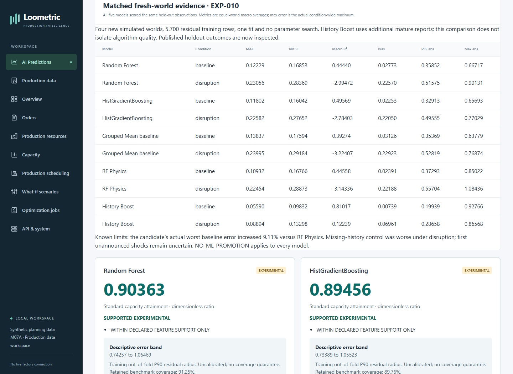

# Loometric

A local garment production planning and analytics project. Build synthetic production
scenarios, compare schedules and explore experimental pre-shift forecasts.

**Stack:** Python, FastAPI, pandas, scikit-learn, OR-Tools, React and TypeScript.

## Features

- Create or import synthetic orders, resources, shifts and calendars.
- Calculate capacity, generate schedules and inspect independently verified Gantt results.
- Compare what-if scenarios and run bounded optimization jobs with cancellation.
- Compare History Boost, RF Physics, Random Forest, histogram boosting and Grouped Mean predictions.
- Validate garment productivity CSVs and reproduce documented offline ML experiments.

## Local setup

Requires Python 3.13 and Node.js 22.12+ (22.x), 24.x or 26+.
Commands below use Windows PowerShell from the repository root.

**Dashboard:**

```powershell
cd frontend
npm ci --ignore-scripts
npm run dev
```

Open **http://127.0.0.1:5173**. Fixture preview works without a backend.

**Backend:** open another terminal in the repository root.

```powershell
py -3.13 -m venv .venv
.\.venv\Scripts\python.exe -m pip install -r requirements/m05a.txt
.\.venv\Scripts\python.exe -m pip install --no-deps -e ".[dev,ml,optimization,api]"
$env:LOOMETRIC_API_TOKEN = & .\.venv\Scripts\python.exe -c "import secrets; print(secrets.token_urlsafe(32))"
.\.venv\Scripts\python.exe -m loometric.api
```

In the dashboard, select **Configure API**, use **http://127.0.0.1:8000** and enter
that terminal session's Bearer token. API documentation: **http://127.0.0.1:8000/api/v1/docs**.

**AI Predictions** defaults to RF Physics and requires trusted local v1/v2 model
artifacts, which are not included in Git. Prepare them separately using the
[reproducible artifact setup](docs/architecture/experimental-ml-inference.md#reproducible-v2-artifact-preparation)
before requesting predictions; the rest of the app can run without them.
Models are never trained automatically during inference.

The optional fifth model, **History Boost**, additionally requires the trusted
v3 bundle and mature past-shift context. Follow its
[artifact preparation and verification](docs/architecture/mature-history-experimental-inference.md#reproducible-artifact-preparation).
Choose **Compare all five models**, enter your hypothetical historical summaries
and inspect matched baseline/disruption evidence. Missing or stale history
abstains; candidate point estimates require review.

For a production-build portfolio demo, use `npm run build` and `npm run preview`
in `frontend/`, alongside the same local API. The [deployment guide](docs/deployment.md)
includes an optional exact-origin HTTPS gateway template and operating limits.
No public service was deployed. Frozen model receipts bind the validated Windows
environment; an untested Linux container deployment is not claimed.



[Mobile candidate view](docs/screenshots/final-predictions-mobile.png) uses the same
real local API response and explicitly hypothetical inputs.

## Checks

From the repository root:

```powershell
.\.venv\Scripts\python.exe -m pytest -q
.\.venv\Scripts\python.exe -m ruff check .
.\.venv\Scripts\python.exe -m ruff format --check .
cd frontend
npm test
npm run typecheck
npm run check
npm run build
```

Run `npm run test:browser` from `frontend/` for browser workflows; trusted local
model artifacts are required. Detailed final verification results are in the
[portfolio verification record](docs/portfolio-verification.md).

## Scope and limitations

- Planning demos use synthetic data; there is no connection to factory systems.
- Forecasts estimate synthetic standard capacity attainment, not employee efficiency
  or guaranteed output. Models remain experimental: **NO_ML_PROMOTION**.
- RF Physics metrics come from previously inspected validation data. No independently
  calibrated prediction band is available. Predictions never set planning capacity or efficiency.
- Sessions, drafts and jobs are memory-only. No database or cloud deployment is included.

One fixed **History Boost** candidate was trained on 5,700 separate development
targets, with no parameter search. On four fresh held-out synthetic worlds:

| Model | Baseline MAE | Disruption MAE |
| --- | ---: | ---: |
| Grouped Mean | 0.13837 | 0.23995 |
| Random Forest | 0.12229 | 0.23056 |
| RF Physics | 0.10932 | 0.22454 |
| History Boost | **0.05590** | **0.08894** |

History Boost reduces macro MAE versus RF Physics by **48.87% /60.39%** and versus
Random Forest by **54.29% /61.43%** (baseline/disruption). Its macro R² is
**0.81017 /0.12239**. It uses additional mature history and new training data;
these gains do not isolate algorithm quality. All 41 predeclared demo integration
guards passed, and frozen A/B predictions/reports reproduced byte-identically.

Baseline worst error still rose **9.11%** versus RF Physics. Missing-history
control was inferior; first hidden shocks, disruption bias and absent factory
validation remain limitations. The heldout was independent of candidate selection
on first access; published outcomes are now **spent**, and B is reproduction,
not another independent validation sample. See [EXP-010](docs/experiments/EXP-010-mature-history-candidate.md).
**NO_ML_PROMOTION** and all reserved datasets remain preserved.

On 4,833 **spent synthetic benchmark validation** rows, RF Physics MAE is
**0.05793136**, a **24.05% reduction versus Forest12** (0.07627744); RMSE is
**0.09936277** and R² **0.82067**. These are reproduced historical diagnostics,
not independent validation or factory-performance evidence. Hidden disruptions,
stage regressions and worst errors remain unresolved; see [EXP-008](docs/experiments/EXP-008-ml-improvement-research.md).

[EXP-009 prospective frozen evaluation](docs/experiments/EXP-009-prospective-frozen-results.md)
completed on four new synthetic worlds with byte-identical A/B results. RF Physics
baseline macro MAE is **0.115372**, **4.79% lower than Forest12** and **12.22% lower
than Grouped Mean**. Disruption MAE is **0.203759**. The primary bootstrap interval
includes zero and 31 numerical guards fail: **REPLICATION_NOT_SUPPORTED**.
These inspected synthetic outcomes do not establish factory validity or authorize promotion.

## Documentation

- [Dashboard setup and workflows](frontend/README.md)
- [Planning and capacity](docs/architecture/production-planning-domain.md),
  [scheduling](docs/architecture/scheduling-contract.md) and
  [scenario comparison](docs/architecture/what-if-scenario-engine.md)
- [Prediction contracts](docs/architecture/experimental-ml-inference.md) and
  [RF Physics research](docs/experiments/EXP-008-ml-improvement-research.md)
- [History Boost architecture and reproducible setup](docs/architecture/mature-history-experimental-inference.md),
  [EXP-010 results](docs/experiments/EXP-010-mature-history-candidate.md) and
  [portfolio deployment preparation](docs/deployment.md)
- [EXP-009 prospective frozen-model protocol](docs/experiments/EXP-009-prospective-frozen-evaluation.md)
  and [actual results](docs/experiments/EXP-009-prospective-frozen-results.md)
  — completed under the unchanged declaration; NO_ML_PROMOTION.
- [Prospective dataset integrity infrastructure](docs/architecture/prospective-dataset-infrastructure.md)
  — eight actual cases generated, reproduced and independently registered; raw outputs ignored.
- [Frozen evaluation engine](docs/architecture/prospective-frozen-evaluation-engine.md)
  — sealed inference, diagnostics and independently verified byte-identical reproduction.
- [Dataset profile](docs/data_profile.md) and [pre-shift feature policy](docs/prediction_problem.md)
- [Architecture decisions](docs/decisions/) and [experiment reports](docs/experiments/)
