# M05A: Bounded local FastAPI foundation

M05B now adds [bounded asynchronous optimization jobs](optimization-jobs-api.md),
including DELETE cancellation on the same local authentication/transport boundary.
The synchronous budgets and M05A verification record below remain preserved; statements
about deferring jobs describe this original milestone's scope.

The optional API exposes existing synthetic planning engines. It does not train or
load models, touch protected ML data, schedule jobs, or authorize production.
See [ADR 0013](../decisions/0013-local-api-and-bounded-synchronous-execution.md).

## Architecture and preserved boundaries

| Module | Responsibility |
| --- | --- |
| `api/app.py` | Explicit application construction, safe exception handlers, local documentation |
| `api/routes.py`, `schemas.py` | `/api/v1` routes, closed Pydantic envelopes, OpenAPI request/response contracts |
| `api/security.py`, `errors.py` | Local peer/Host/origin checks, Bearer auth, correlation IDs, sanitized errors |
| `api/settings.py`, `default_limits.json` | Trusted startup settings and packaged resource limits |
| `api/codec.py` | Bounded strict JSON, exact Decimal input encoding |
| `api/services.py` | Nonqueued admission, off-loop process supervision and cancellation cleanup |
| `api/worker.py`, `operations.py` | Guarded parsing and adapters calling unchanged engines |
| Existing `execution.py` | M03C/M04 native memory guard and process wall watchdog |

```mermaid
flowchart LR
    H[Loopback HTTP] --> G[Host / origin / body header gates]
    G --> A[Configured Bearer authentication]
    A --> L[Two admission slots and bounded body read]
    L --> T[Off-loop supervisor thread]
    T --> P[Hard guarded child process]
    P --> J[Strict Decimal JSON and closed envelope]
    J --> D[Existing domain parsers and engines]
    D --> V[Independent verification / existing report serializers]
    V --> R[Bounded versioned result or sanitized error]
```



HTTP code does not change M02 entities, M03A dispatch/verifier, M03B objective order,
or M04 atomic transformation/selection semantics. The only existing shared execution
change adds the private API worker to the fixed worker-module allowlist. Clients
cannot choose worker modules, file paths, solver settings, resource limits or models.
Domain modules never import FastAPI or Pydantic. All input-dependent parsing and
engine work runs under the same native process guard used by M03C/M04.

## Endpoint contracts

All paths below begin `/api/v1`. Health and documentation are public **only to
loopback peers with a literal local Host**. Other endpoints require Bearer auth.
No endpoint accepts query parameters. POST requires `application/json`, optionally
with `charset=utf-8`; content compression and uploads are unsupported.

| Method/path | Request | Successful `data` |
| --- | --- | --- |
| GET `/health` | None | Process `status=ok`, API version and service name; not dependency/operational readiness |
| GET `/capabilities` | None | Frozen policy, supported changes/greedy method, exact limits, deferred features and limitations |
| POST `/planning/capacity` | `{"scenario": <M02 input>}` | Existing capacity report; independent-slot assessment, schedule feasibility NOT_ASSESSED |
| POST `/scheduling/dispatch` | `{"instance": <M03 instance>}` | Greedy proposal, fingerprint, verification, metrics, synthetic provenance/assumptions, producer and limitations |
| POST `/scheduling/verify` | `{"instance": <M03 instance>, "schedule": <proposal>}` | Independent verification and metrics only when feasible; producer `external_proposal` |
| POST `/scenarios/compare` | `{"baseline": <M03 instance>, "specification": <M04 specification>}` | Unchanged M04 comparison with baseline/scenario evidence, provenance, producers, deltas and limitations |
| GET `/openapi.json` | None | OpenAPI specification with Bearer security and request/error envelopes |
| GET `/docs` | None | Self-contained local HTML endpoint guide linking OpenAPI JSON; no CDN or external scripts |

Pydantic defines strict closed outer envelopes. Nested objects use the complete
existing CLI schemas and their original strict parsers, rather than duplicated HTTP
domain models. OpenAPI labels these nested values as objects; it does not encode
every domain invariant. Use the contracts and executable frozen inputs:

- [M02 contract](production-planning-domain.md), [capacity input](../../examples/planning/capacity-demo.json)
- [M03A contract](scheduling-contract.md), [instance](../../examples/scheduling/competition.json)
- [M04 contract](what-if-scenario-engine.md), [baseline](../../examples/scenarios/capacity-baseline.json), [changes](../../examples/scenarios/additional-workers.json)

For capacity, put the original M02 file inside `scenario`; for dispatch, put the
original M03 file inside `instance`. For verification, pass the returned `data.schedule`
unchanged. For comparison, wrap the original M03 and M04 files as `baseline` and
`specification`. These are JSON objects, never path names or JSON-encoded strings.

Planning numeric inputs retain JSON **number tokens**, decoded as Decimal. A value
such as `0.1234567890123456789012345678` survives HTTP parsing and instance hashing
exactly. Generic binary-float decoding followed by re-encoding can change input
identity; use the example client or another exact-number JSON implementation.
Existing reported Decimal quantities remain **strings**, including proposal labor
fields. Do not convert a capacity report back into planning input by guessing types.
There is no imputation, clipping, policy coercion or normalization of invalid inputs.
Unknown fields, duplicate decoded keys, nonfinite/malformed values, invalid Unicode,
unsupported versions and invalid references fail explicitly.

Every success is wrapped as:

```json
{
  "api_version": "v1",
  "request_id": "server-generated-UUID",
  "data": {"status": "ok", "api_version": "v1", "service": "loometric"}
}
```

The same ID is in `X-Request-ID`; caller-supplied IDs are not reflected. Dispatch
includes `producer=greedy`, the original algorithm ID, `optimality_claim=false`,
`synthetic=true`, assumptions, `verification.status`, metrics and limitations.
An executable well-formed verification request returns 200 with `INVALID` when its
proposal violates feasibility; metrics are null. This differs from 422 malformed
domain input and 200 `VALID_PARTIAL`, which is a feasible but incomplete schedule.
M04 retains its selected producer, explicit feasible/complete verification evidence,
same-demand/specification fingerprints, frozen objective comparison and conditional
limitations. The existing optional ResourceLimits argument records the API's actual
96-operation/256 MiB/5s envelope in its resource_policy; other CLI report values are
identical for greedy inputs. No optimizer runs or optimality proof is manufactured.

## Local authentication and transport policy

The supported command binds `127.0.0.1`, one Uvicorn/asyncio worker, without reload,
proxy-header trust, access logs or server-version headers. HTTP requests also check
their actual ASGI peer is loopback and Host is literal `localhost`, `127.0.0.1` or
`[::1]`, with an optional valid port. Forwarded headers cannot establish local access.
Remote/rebinding Host values are rejected. Do not mount behind a reverse proxy:
proxying remote users through loopback would defeat the meaning of this peer check.

Set `LOOMETRIC_API_TOKEN` to a locally generated random URL-safe secret of32–128
ASCII characters. Missing/invalid configuration fails closed before server startup.
Send `Authorization: Bearer <your configured secret>` on protected requests; comparison
uses `secrets.compare_digest`. There are no embedded/example credentials, query-string
credentials, token persistence, cookies or automatic `.env` loading. Token settings
use Pydantic SecretStr. Startup errors, API errors and logs omit raw exception/input
text. Internal failure logs contain only a generated request ID and fixed error code.

Explicit browser origins are `http://localhost:5173` and `http://127.0.0.1:5173`.
No wildcard origins or credentialed CORS. Allowed preflight methods are GET/POST and
headers Authorization/Content-Type. Other origins/preflights are rejected. Origin
is browser policy metadata, not authentication. Trusted `Settings` construction may
replace the allowlist only with literal loopback HTTP origins on ports1024–65535.

This shared-secret, unencrypted loopback HTTP policy is for a trusted single-user
machine. It provides neither tenant separation nor protection from a compromised
local account, browser extension or OS. No public hosting, LAN exposure, tunneling,
TLS termination, multiple server workers or reverse proxy deployment is supported.

## Resource limits and cancellation

Defaults live in [packaged configuration](../../src/loometric/api/default_limits.json).
Trusted startup construction can reduce validated limits; HTTP cannot override them.

| Dimension | Limit |
| --- | ---: |
| Request bytes | 262,144 (256 KiB), declared length and streamed bytes checked |
| Encoded child response | 2,097,152 (2 MiB), before returning to HTTP parent |
| JSON nesting | 24, checked before recursive decoding |
| JSON nodes | 10,000, including dictionary keys |
| Items per object/array | 256 |
| String characters, including keys | 4,096 |
| Integer/Decimal coefficient digits | 128 |
| Decimal exponent magnitude | 100 |
| Orders per planning input | 32 |
| Required order-stage operations per input | 96 |
| Changes in a comparison | 64 |
| Simultaneous admitted POST requests | 2, including body reading and process cleanup |
| Body read deadline | 3 seconds |
| Child watchdog | 5 seconds, process startup/parsing/engines/serialization included in supervised work |
| Hard memory per child | 256 MiB |

Admission is nonqueued: a third expensive request receives429 with Retry-After 1.
Header size rejection precedes any body parsing; streaming bodies are counted even
without Content-Length. Body timeout returns 408. Health/capabilities stay off the
worker admission path. The response cap prevents unbounded parent-side report work.

The existing guard assigns a suspended Windows launcher to an aggregate-memory,
kill-on-close Job Object before releasing it; the child checks membership and limit.
Linux uses RLIMIT_AS; unsupported/unavailable guards fail closed. The parent executes
this blocking guard in a thread. On watchdog expiry it kills/reaps the actual process
(and Windows launcher/interpreter job), then returns 504. The 5-second communication
watchdog plus process launch/job setup and teardown overhead is not an exact HTTP
latency SLA. Body reading has its separate 3-second bound. Supported Uvicorn also
limits connections/tasks to 32, backlog 32, keepalive 5s and graceful shutdown 10s.
Transport-level rejection/malformed HTTP can occur before ASGI and may use Uvicorn's
own response rather than an application correlation envelope.

A disconnected/cancelled HTTP caller does **not** cause immediate CPU cancellation.
Work may complete or hit the same hard watchdog. AnyIO cancellation shielding and
explicit asyncio cancellation cleanup retain the admission slot and await the same
bounded job before propagating cancellation. Cancelling a wait never creates an extra
live execution slot. There is no job ID, result retention, retry/deduplication policy,
crash recovery or caller-owned cancellation endpoint in M05A. These are M05B decisions.

## Safe errors

```json
{
  "api_version": "v1",
  "request_id": "server-generated-UUID",
  "error": {
    "code": "DOMAIN_VALIDATION_FAILED",
    "message": "Input failed domain validation.",
    "details": [{"domain_code": "UNKNOWN_REFERENCE"}]
  }
}
```

| HTTP status | Examples |
| --- | --- |
| 400 | INVALID_JSON, INVALID_HEADERS, UNSUPPORTED_QUERY, CLIENT_DISCONNECTED |
| 401 | AUTHENTICATION_REQUIRED, WWW-Authenticate Bearer |
| 403 | LOCAL_ACCESS_ONLY, LOCAL_HOST_REQUIRED, ORIGIN_REJECTED, CORS_REJECTED |
| 404 / 405 | HTTP_ERROR for unknown path or unavailable method |
| 408 | BODY_TIMEOUT |
| 413 | BODY_TOO_LARGE |
| 415 | JSON_REQUIRED, CONTENT_ENCODING_UNSUPPORTED |
| 422 | INVALID_ENVELOPE, DOMAIN_VALIDATION_FAILED, INVALID_VALUE, SYNTHETIC_REQUIRED, INPUT_LIMIT_EXCEEDED, RESPONSE_LIMIT_EXCEEDED, UNSUPPORTED_METHOD |
| 429 | SERVER_BUSY |
| 500 | EXECUTION_FAILED, INTERNAL_ERROR |
| 503 | RESOURCE_GUARD_UNAVAILABLE, MEMORY_LIMIT_EXCEEDED |
| 504 | EXECUTION_TIMEOUT, after actual process termination/cleanup |

Domain codes and fixed schema rules are safe structured details. Raw Pydantic errors,
submitted field names/values, native stderr, stack traces, local paths and credentials
are never copied into error envelopes. Hard OS memory kills without a worker receipt
can surface as generic 500 EXECUTION_FAILED; do not label them proven infeasibility.
Success/error responses set Cache-Control no-store, nosniff and no-referrer.

## Reproduction and dependency snapshot

From the repository root, PowerShell:

```powershell
.\.venv\Scripts\python.exe -m pip install -r requirements/m05a.txt
.\.venv\Scripts\python.exe -m pip install --no-deps -e ".[dev,ml,optimization,api]"
$env:LOOMETRIC_API_TOKEN = & .\.venv\Scripts\python.exe -c "import secrets; print(secrets.token_urlsafe(32))"
$env:LOOMETRIC_API_PORT = "8000"
.\.venv\Scripts\python.exe -m loometric.api
```

Keep the captured secret in the local environment; never paste it into source,
screenshots or logs. In another terminal configured with the **same** secret/port:

```powershell
.\.venv\Scripts\python.exe examples/api/workflow.py
```

The [client](../../examples/api/workflow.py) uses exact input encoding, fixed loopback,
disabled proxy-environment trust and disabled redirects. It exercises health,
capabilities, capacity, dispatch, verification and scenario comparison. The frozen
synthetic fixture completes 45 baseline units and 55 with additional hypothetical
workers. This is conditional arithmetic, not observed factory productivity.
The client prints summary identities/statuses, never credentials.

For a self-contained test that generates an ephemeral token/port, starts the real
local server, runs that workflow **twice**, compares summaries and stops the server:

```powershell
.\.venv\Scripts\python.exe -m pytest tests/api/test_local_server.py -q
.\.venv\Scripts\python.exe -m pytest tests/api -q
.\.venv\Scripts\python.exe -m pytest -q
.\.venv\Scripts\python.exe -m ruff check .
.\.venv\Scripts\python.exe -m ruff format --check .
.\.venv\Scripts\python.exe -m pip check
```

Requirements retain all 23 old M03B/ML pins and add 16 exact API/test/transitive pins,
including FastAPI 0.165.0, Pydantic 2.14.4/core 2.50.5, Starlette 1.10.0, Uvicorn 0.54.0,
HTTPX 0.28.1 and AnyIO 4.16.0. HTTPX is a dev/client dependency; API is optional.
The selected Starlette deprecates its HTTPX TestClient adapter, so acceptance tests
use HTTPX ASGITransport directly without suppressing warnings or adding HTTPX2.
Dependency resolution/installation was verified on Python 3.13.14 Windows x86-64.
The defaults JSON is included in wheel package data. Exact cross-platform wheels
and Linux resource behavior have not been independently validated in this milestone.

Primary references: [FastAPI release](https://pypi.org/project/fastapi/0.165.0/),
[Pydantic release](https://pypi.org/project/pydantic/2.14.4/),
[AnyIO thread cancellation](https://anyio.readthedocs.io/en/stable/threads.html),
[FastAPI constant-time secret comparison](https://fastapi.tiangolo.com/advanced/security/http-basic-auth/).

## Verification evidence and limitations

Final verification on the local Python 3.13.14 / Windows environment:

| Check | Actual outcome |
| --- | --- |
| `pytest tests/api -q` | 76 passed in 22.89s, including two live-server startup checks |
| `pytest -q` | 888 passed in 84.97s; all 812 pre-existing tests retained |
| `ruff check .` | All checks passed |
| `ruff format --check .` | 166 files already formatted |
| `pip check` | No broken requirements found |
| Installed dependency comparison | All 39 exact pins match; all 23 earlier pins preserved |
| Editable install, all four extras | Passed with --no-deps --no-build-isolation |
| Local wheel build and inspection | Passed; packaged defaults JSON present, no raw data/local instruction files |
| Real HTTP reproducibility | One actual server, two client processes; identical summary identities/statuses, 45 to 55 synthetic units |
| Protected file comparison | 179 earlier files byte-identical; only README, pyproject and execution worker allowlist intentionally changed |
| Documentation links | 38 local targets resolved |
| Git whitespace check | Passed; AGENTS.md and local COMMIT_PLAN.md remain ignored/untracked |

Initial sandbox pytest finished its cases but failed writing an existing cache
directory; rerunning with ordinary filesystem permission succeeded. During development,
an additional direct asyncio cancellation test exposed premature slot release; the
regression test now passes after explicit cleanup waiting. Initial fixture-summary
field lookup mistakes and routine Ruff findings were corrected before their verified
commits. No unresolved test failure remains. No historical experiment was rerun and
no new ML accuracy or operational readiness claim is made.

Tests cover all six
endpoints, exact Decimal fingerprints, strict JSON/envelopes/domain restrictions,
authentication, local peers/Hosts/CORS, body/complexity/response limits, concurrency,
body deadlines, actual native termination, cancellation cleanup, safe errors/logs,
baseline immutability, independent verification and repeated comparison identity.
A fresh-process audit forbids protected data/model paths and ML/OR-Tools imports in
both server probe and inherited native children; it exercises the complete HTTP flow.
The legacy suite protects CLI, M01–M04 contracts and frozen evaluation boundaries.

M01 remains offline: trusted external manifest digests, exact environment agreement,
pickle provenance, review/abstention/evidence policy and replay/real-time distinctions
need a deliberate trusted artifact registry and HTTP safety contract. No inference
endpoint or model/data read is introduced. Existing prediction accuracy conclusions
and untouched final holdout are unchanged.

M05B may reuse this authentication/error/verification boundary but must separately
specify bounded job admission, owner identity, job state transitions, explicit
cancellation that stops actual native work, deadlines, retention, idempotency and
recovery after process failure. Preserve whole-stage-minute-v1, the frozen objective
hierarchy, independent verification and strict greedy fallback. No job orchestration,
database, frontend, deployment or public readiness is implemented by M05A.
