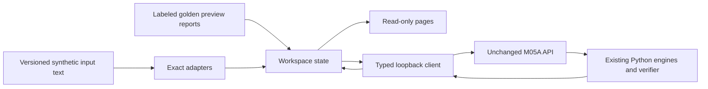

# M06A: Local production inspection dashboard

M06B now extends this foundation with [interactive scheduling, what-if and jobs](interactive-planning-workspace.md).
The record below describes M06A's original scope/results. Explicit M06B correction:
priority **1 is highest**, as frozen in ADR0009; the earlier M06A prose/UI footnote
reversed that description. Only presentation is corrected; scheduling policy/code
and historical measured results were unchanged.

M06A is a read-only React dashboard for the existing synthetic planning contracts.
It inspects orders, declared resources, independent capacity assessments and an
explicitly loaded existing schedule. It does not train models, generate schedules,
submit optimizer jobs, transform scenarios or connect to a factory. See
[ADR 0015](../decisions/0015-local-dashboard-and-exact-presentation.md), the preserved
[M02 contract](production-planning-domain.md), [M03A policy](scheduling-contract.md),
[M04 semantics](what-if-scenario-engine.md), [M05A API](api-foundation.md) and
[M05B limits](optimization-jobs-api.md).

## Stack and responsibility boundaries

The isolated [frontend package](../../frontend/package.json) uses React/React DOM
19.3.1, strict TypeScript 7.0.2, Vite 8.3.8 and plugin-react 6.3.0. Plain CSS tokens,
small inline SVG icons and native semantic controls avoid a component library,
charting framework, font CDN and external assets. Native hash routes avoid a router
dependency and server rewrite. No global state framework is needed.

`lossless-json` 4.3.4 is the only additional runtime dependency. Biome 2.6.8 provides
lint/format checks; Vitest 5.1.1, Testing Library and jsdom 31.0.1 provide focused
tests; Playwright 1.65.1 and axe-core/playwright 4.14.0 test the real browser. All
direct versions are exact and the npm lockfile is versioned. Python packages and
the 39 existing M05A dependency pins are unchanged.

| Location under `frontend/` | Responsibility |
| --- | --- |
| `src/layout/Layout.tsx`, `src/App.tsx` | Sidebar, header, hash navigation, page mounting, session form |
| `src/components/` | Accessible controls, panels, table scrolling, report states, provenance and bars |
| `src/domain/json.ts`, `exact.ts` | Bounded lossless JSON, exact display/count totals and bounded visual ratios |
| `src/domain/models.ts`, `adapters.ts` | Typed presentation models and supported contract checks |
| `src/api/client.ts` | Literal loopback transport, auth, bounded responses, cancellation, safe errors |
| `src/state/Workspace.tsx` | Tab session, selected input, request ownership, loading/error/report state |
| `src/pages/` | Five inspection pages with no Python domain formulas |
| `src/demo/catalog.ts`, `fixtures/` | Explicit input selection and separately labeled golden preview reports |
| `tests/`, `browser/`, `scripts/browser-test.mjs` | Unit/component checks and owned real-backend browser harness |

There is no frontend capacity/availability/feasibility algorithm. Sorting, filtering,
counting orders, summing unique reported slots and formatting exact values are
presentation operations. Preprocessing, ML, calendars, interval unions, standards,
potential output and scheduling verification stay in the existing Python modules.

## Navigation and page contracts

| Route | Inputs and displayed meaning |
| --- | --- |
| `/#/overview` | Unique order count/quantity, declared lines/shifts, reported available worker-minutes, per-assignment available/gross bars, source assumptions; saved outcome only after explicit loading |
| `/#/orders` | Search order/style/stage; sort IDs, exact quantities/priorities and ISO dates; inspect required stages, stage standards and declared line–style capability IDs |
| `/#/resources` | Declared crew/availability, capabilities, profile evidence/assumed efficiency, assignment references, shift intervals/breaks, downtime and unavailability |
| `/#/capacity` | M02 elapsed/worker/standard minutes; unique assignment rows; order-stage-slot potential pieces, incompatibility/null handling, reason codes and independent-assessment limitations |
| `/#/system` | Actual loaded health/version/capabilities and execution limits; memory-only session clearing; explicit M01 offline/M06B boundaries |

Dataset selection clears the previous report and schedule. Late responses cannot
replace a different dataset/session; selection during the health/capabilities
handshake uses the latest input. Disconnect/unmount abort outstanding requests and
clear the client's secret. Refresh clears any previously loaded schedule. Empty,
loading, invalid-contract, authentication, bounded-busy/timeout, disconnected and
network-error states use deliberate text. Failed live requests do not fall back to
preview results. Health/status is a last successful check/response, not a heartbeat.

## Provenance and reproducible synthetic preview

There is no dataset-catalog endpoint. The small explicit catalog imports the
original input text directly; no source fixture is edited or silently relabeled:

| Selection | Source | Actual preview content |
| --- | --- | --- |
| Capacity foundation | [M02 capacity demo](../../examples/planning/capacity-demo.json) | 6 orders, 480 requested pieces, 5 lines, 2 shifts, 6 assignment slots, 42 independent assessments (18 compatible) |
| Competing orders | [M03A competition](../../examples/scheduling/competition.json) | 2 orders, 140 requested pieces, 1 line/shift/slot, 2 independent assessments; one separately loaded saved partial schedule |

`frontend/fixtures/` contains small intentionally versioned golden UI/contract test
fixtures, obtained from the unchanged engines: capacity outputs from
`report_to_dict(assess_scenario(load_scenario(...)))` / embedded instance planning;
the saved proposal and verified outcome from the existing M03A `dispatch` CLI.
The real-backend tests compare both complete capacity report objects to these
fixtures and reverify the saved proposal. No CP-SAT is executed by the UI/demo.
These golden fixtures are distinct from ignored runtime exports/model artifacts.

The UI always shows **SYNTHETIC**, scenario ID, selected mode, input path and source
text hash. Fixture preview says **Saved M02 report**. An accepted live capacity
report says **API response** and includes its actual request ID; a failed request
labels the provenance as input-only. Preview health/limits are not fabricated.

[Source identities](../../frontend/fixtures/sources.json) use SHA-256 of UTF-8 JSON
text with CRLF normalized to LF, explicitly labeled in the UI. This makes Git
checkout line endings irrelevant. They do not replace the existing canonical
scheduling fingerprint or the frozen ML dataset/split hashes:

- Capacity input: `24c12131599eaf8c9b4ea1451ba80d6fb36265bf769d426613eed4535c967bc9`.
- Competition input: `e4be25ddbd4794bda3baece93e4f268e196263b7ace6e0856d9f9f9ed26eb20e`.
- Saved verified instance: `f84788b106e2d42de3b99adcfc53f6c24b7f7e145ba3ff8d61be74d41df5ab26`.

## Visualization and exact-value semantics

Planning input Decimal values must remain **JSON numeric tokens**, while M05A
report Decimals are **strings**. Native `JSON.parse`/`Number` would destroy some
input precision. Lossless parsing and serialization retain numeric lexemes;
presentation models use decimal/integer strings and BigInt display arithmetic.
The pipeline preserves `0.1234567890123456789012345678` and integers beyond the
JavaScript safe-integer range. Zero remains zero; an incompatible potential output
is **Not applicable**, not zero. Unknown/malformed contracts are rejected.

Bar widths use a deliberately quantized, bounded basis-point ratio only for CSS
layout. Exact values/units remain in adjacent text and tables. No metric is clipped
or replaced to improve presentation. Dates show the declared date/offset without
browser timezone conversion. Priority 1 is highest under the frozen scheduling policy (corrected in M06B as
noted above); no risk score is invented.

The M02 demo actually reports totals of **2,160 elapsed minutes**, **5,490
worker-minutes**, and **4,414.5 standard worker-minutes** across six unique slots.
These sums describe capacity inputs across stages/crews; capacity is not fungible
between stages. Independent assessment rows reuse slots and are never added to
form a production plan. The chart denominator is each assignment's own gross
elapsed minutes. Downtime/break/unavailability values come from the report's union
calculation; the frontend never subtracts overlapping restrictions itself.

**Load saved outcome** reads the existing proposal. In API mode it calls only
`POST /api/v1/scheduling/verify`; in preview it explicitly reads its saved golden
verification. The real example is **VALID_PARTIAL**, with **60 completed / 80
unfinished pieces**. Line utilization is **225 / 480 net line-minutes = 46.875%**;
standard-capacity utilization is **720 / 1,536 standard worker-minutes = 46.875%**.
Both numerators, denominators and ratios come from the verified report. Completed
means all required stages; these are synthetic scheduling results, not production
telemetry. Invalid proposals have no displayed metrics. There are no historical
trends, financial savings, ML confidence or live production KPIs.

## API, authentication and local startup

Only existing M05A routes are used: health, capabilities, planning capacity and
existing-proposal verification. M05B job limits are read-only metadata. No catalog,
prediction, dispatch, scenario or optimizer endpoint is invented or added.

The client accepts only a literal `http://127.0.0.1:<port>` or
`http://localhost:<port>` origin, ports 1024–65535, with no userinfo, paths, query,
fragment or normalized numeric-host alias. Requests use that single origin, omit
cookies/referrers, reject redirects and serialize exact JSON. The request cap is
256 KiB, response cap 2 MiB + envelope allowance, nesting cap 24, and client deadline
12 seconds. Errors use fixed safe messages and checked request IDs; raw exception
text, echoed credentials and response internals are not logged/displayed.

The token is entered through a password field and retained only in the current
tab's private API client; submitting clears the form. It is never written to
localStorage/sessionStorage, a URL, build-time environment, analytics or logs.
Clearing/reloading the session removes it. This is the existing local-session
security model, not public authentication or a multi-user authorization system.

Vite dev/preview bind **127.0.0.1:5173**, fail on an occupied port and use no proxy.
This matches the unchanged backend's restricted CORS origins. The dev filesystem
allowlist is limited to the frontend and the two synthetic example directories;
raw datasets, `.git`, local instructions and model artifact directories are outside
it. No cloud infrastructure, deployment, public hosting or external assets exist.

Follow the exact [local startup and verification commands](../../frontend/README.md).
Fixture preview requires only `npm ci --ignore-scripts` and `npm run dev` inside
`frontend/`. Actual API mode additionally requires the existing root `.venv` and
M05A server. Open **http://127.0.0.1:5173**, choose a dataset and **Configure API**;
on **API & system**, inspect actual health/limits or clear the session. Use the
competition fixture and **Load saved outcome** for verified result inspection.

## Accessibility and responsive behavior

Light theme, labeled native controls, semantic landmarks/headings/tables, visible
keyboard focus, a skip-to-content control and non-color status text are shared
across pages. Sort headers expose `aria-sort`; data tables are named focusable
scroll regions. Native modal dialogs provide Escape/focus trapping and return
focus to the opener; route focus uses `preventScroll` to retain header visibility.
The jsdom dialog lifecycle shim is test-only; real browser tests use native dialogs.

Desktop uses a persistent sidebar; tablet reduces card columns; narrow layouts use
a navigation toggle and vertically stacked sections. Closed mobile navigation is
not keyboard-visible. Tables scroll inside their panel rather than widening the
page. Reduced-motion settings disable the spinner and sidebar transition. Charts
have text legends, units, exact text values and a corresponding table on Capacity.

## Verification record

Measured on 2026-11-21 in Windows, Python 3.13.14, Node 26.13.0/npm 11.20.0, headless
system Microsoft Edge. These are the actual tested views/environment; axe smoke
checks are not a WCAG certification or cross-browser compatibility claim.

Frontend type/lint/build and 38 unit/component tests pass. Four owned real-backend
browser tests cover complete saved-vs-actual capacity responses and high precision,
all five pages, search/order routing, explicit saved-proposal verification, session
clearing/reload, keyboard/dialog behavior, 1440×1050 / 820×1100 / 390×844 layouts,
no page overflow, authentication/network failures, no external asset requests or
browser credential storage, and denied development-filesystem access. Axe WCAG
2 A/AA and 2.1 AA smoke checks pass for the tested pages/dialogs/layouts, including
verified outcome and error states. The harness closes its owned listeners.

The browser command creates a random ephemeral token and isolated API port; no
existing listener is reused. It redacts credentials before emitting failure output,
keeps traces/videos/automatic screenshots off, sanitizes textual failure evidence
and writes manual screenshots only outside credential entry. It starts no solver
job. Screenshots remain ignored under `.tmp/frontend/`: `overview-desktop.png`,
`orders-desktop.png`, `capacity-desktop.png`, `system-api.png`,
`verified-existing-outcome.png`, `overview-tablet.png`, `capacity-mobile.png`.

Initial development failures were corrected: sandbox `spawn EPERM` required the
test runner's normal child-process permission; jsdom required a test-only dialog
shim; Node's JSON module import needed its import attribute; browser fetch needed
the proper native receiver; axe caught small-text contrast and scroll-region focus
issues. A line-ending format mismatch was fixed with frontend-only LF attributes.
No earlier failed run is counted as a pass.

| Executed check | Actual final outcome |
| --- | --- |
| `npm ci --ignore-scripts` | Clean lockfile installation: 106 packages added, 107 audited, zero vulnerabilities |
| `npm run typecheck` | Pass, including strict source, component tests, browser tests and configs |
| `npm run check` | Pass: Biome checked 31 files, no changes/errors/warnings |
| `npm test` | 38 passed in two files, 5.69 s |
| `npm run build` | Pass, 47 modules; final JS 343.35 kB / 91.35 kB gzip, CSS 18.89 / 4.87 kB |
| `npm run test:browser` | 4 passed, final run 14.6 s; previous complete run 17.5 s also passed; owned listeners closed |
| `npm audit --audit-level=low` | Zero vulnerabilities in full dependency tree |
| `npm ls --depth=0` | All 17 exact direct runtime/dev packages resolved without missing/invalid dependencies |
| Root `.venv` pytest `-q` | 940 passed in 165.38 s |
| Root Ruff lint | All checks passed |
| Root Ruff format check | 187 files already formatted |
| Root `pip check` | No broken requirements |
| Recursive `requirements/m05a.txt` pin audit | All 39 installed versions match, zero mismatches |
| Protected-file SHA-256 audit | All 225 original files other than the intentionally updated README match their starting bytes |
| Git ignore/index checks | Local rules/plan, CSV, dependencies, builds and screenshots excluded |

The only surviving runner warning is Playwright's `NO_COLOR`/`FORCE_COLOR`
interaction; checks complete successfully. No backend defect, API schema change,
Python dependency update, solver change or ML evaluation was needed.

## Limitations and M06B handoff

The catalog deliberately contains only two known synthetic examples. There is no
arbitrary file upload/editor, database, persistence or live factory connection.
Golden preview reports can become stale if domain contracts change; complete real
API comparisons are the guard. Source fixtures and backend contracts are frozen
for this milestone. There is no continuous connectivity polling, automatic retry,
large-table virtualization or unverified browser/platform claim. A browser refresh
intentionally discards session/selection/results. Loopback services remain subject
to the existing bounded admission, body, memory and runtime limits.

M06B can reuse the typed transport, session ownership, provenance and report panels
for explicitly scoped scheduling/what-if workflows. It must add reviewed request
contracts, lifecycle/poll/cancel UI and failure tests around the existing bounded
M05B jobs, preserve exact Decimal transport and distinguish verified fallback,
partial/invalid results and solver proof status. It must not infer a global plan
from M02 capacity checks or connect M01 predictions to capacity without a separately
approved evidence contract. No M06B implementation is included here.
