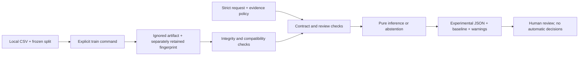

# M01: Experimental offline prediction contract

This local interface produces a frozen B_RF-01 candidate and a Department Mean
reference for human evidence review. It does not authorize staffing, scheduling or
production decisions. It has no HTTP endpoint, database, frontend, optimizer or
deployment. See [ADR 0007](../decisions/0007-experimental-offline-prediction-contract.md).

## Architecture

| Module | Responsibility |
| --- | --- |
| `prediction/contracts.py` | Strict versioned requests/results, timestamps and JSON validation |
| `prediction/policy.py` | Source-bound evidence assertions, review and abstention rules |
| `prediction/artifacts.py` | Explicit training, lineage, persistence and verified loading |
| `prediction/inference.py` | Predict from an already loaded artifact; no fitting or source reads |
| `prediction/cli.py`, `__main__.py` | Local train/predict commands and JSON presentation |
| Existing shared modules | Feature construction, encoding, B_RF-01 constructor, baseline and data validation/splitting |



The existing experiment commands retain their interfaces and behavior. No new
dependencies are introduced; use the existing ML environment snapshot.

## Input schema version 1

All fields except `shift_id` are required. Extra fields, duplicate JSON keys,
NaN/Infinity and non-object JSON are rejected. Requests receive no stripping,
typo correction, date guessing, imputation or clipping.

| Field | Type and validation | Estimator input? |
| --- | --- | --- |
| `input_schema_version` | Integer `1`; booleans rejected | No |
| `scheduled_date` | Valid `YYYY-MM-DD` calendar date | Date-derived weekday and day of month |
| `department` | Exact `sewing` or `finishing` | Categorical |
| `team` | Canonical positive integer **string**, 1–9 digits; no sign, leading zero or decimal | Categorical identifier |
| `prediction_cutoff` | ISO timestamp with seconds and timezone offset or `Z` | No |
| `source_snapshot_timestamp` | Same timestamp format; cannot be after cutoff or inference reference time | No |
| `source_id` | Nonblank string; no surrounding whitespace/control characters | No |
| `shift_id` | Optional string under the same identifier rules, or null | No |

The nine-digit team limit is a wire-format bound, not evidence about real team IDs.
Unknown but well-formed IDs are handled by policy. Cutoff's local calendar date
cannot follow scheduled date. Scheduled date, cutoff date and inference reference
date must all follow the artifact's last training date. Same-date historical
requests abstain conservatively because training labels have no intraday timestamps.

Offsets are provided by the caller; the software cannot verify factory timezone,
actual shift start or whether a snapshot was captured when claimed. An optional
shift ID preserves provenance but does not establish a validated shift-level model.

The exact features remain department, categorical team, calendar-derived categorical
weekday (Monday=0) and numeric day of month. All availability is **provisional**.
Provenance/cutoff/shift metadata never enters preprocessing. Realized overtime,
incentives, idle measures, targets, WIP, SMV, planned productivity, staffing and style
changes are rejected as extra inputs. No historical target aggregates are added.

The committed [request](../../examples/offline-prediction/request.json) is synthetic:

```json
{
  "input_schema_version": 1,
  "scheduled_date": "2030-01-03",
  "department": "sewing",
  "team": "1",
  "prediction_cutoff": "2030-01-03T07:00:00+03:00",
  "source_snapshot_timestamp": "2030-01-03T06:30:00+03:00",
  "source_id": "synthetic:m01-demo",
  "shift_id": "synthetic-day-shift"
}
```

## Output and review policy

Results include `status`, nullable `predicted_productivity` and `baseline_prediction`,
`model_id`, `model_version`, `input_schema_version`, model configuration fingerprint,
artifact fingerprint, actual `prediction_timestamp`, `as_of_timestamp`, execution
mode, source provenance and structured warning code/message pairs. Model metadata
is null if no artifact was successfully verified. Input schema version names the
supported response contract even when an incoming schema is rejected. Invalid
requests have null validated provenance; malformed raw inputs are not echoed.

Every result includes `experimental=true`, `human_review_required=true` and
`decision_eligibility="NOT_ELIGIBLE_FOR_AUTOMATED_DECISIONS"`. No interval,
confidence score or accuracy guarantee is produced. ABSTAIN has both predictions
null, including when the baseline alone could otherwise be calculated.

| Status | Meaning |
| --- | --- |
| `VALID_EXPERIMENTAL` | Configured evidence assertions and contract checks pass; known categories, current-clock execution and finite outputs. Still requires human review and confers no operational approval. |
| `REVIEW_REQUIRED` | Default when timing/freshness is unverified; also unknown categories, explicit replay or prediction above one. Numeric outputs remain visible for review. |
| `ABSTAIN` | Invalid/missing fields, invalid department, missing/incompatible artifact, schema/configuration/environment/hash drift, source mismatch, future snapshot, passed cutoff, temporal overlap or policy-defined stale data. Unknown team can also be configured to abstain. |

`ReviewPolicy` supports `policy_schema_version=1`, optional `source_id`, optional
`timing_evidence_reference`, optional `maximum_snapshot_age_seconds` with
`freshness_evidence_reference`, and `unknown_team_action` (`review` or `abstain`).
JSON policy files require the explicit version; unsupported fields are errors.
Evidence references require a source binding; freshness limit and evidence must
appear together. A configured age limit is a positive integer, assessed as
inference-reference time minus snapshot time; equality is allowed. No numeric
default is defined. The committed [review policy](../../examples/offline-prediction/review-policy.json)
binds the synthetic source and leaves both kinds of evidence unverified.

References are caller assertions, not proof that the cited evidence exists or that
production owners approved it. Real operational values require documented factory
capture/revision records, assignment effective times, timezone/shift definitions,
data delivery latency, responsible owners and an approved freshness response.
Label finalization, target formula/units and observation grain also require evidence.
No numeric operating SLA is inferred from this historical CSV or synthetic tests.

All outcomes carry the experimental-model limitation. Unknown teams cannot silently
receive an ordinary result even though the existing encoder safely represents them
with zero indicators. Invalid departments never use the baseline's global fallback.
Values above one are retained with review; nonfinite/negative outputs abstain.

`--at` sets an explicit **offline replay reference time**. It adds OFFLINE_REPLAY,
forces at least REVIEW_REQUIRED and never replaces actual execution timestamp.
Without `--at`, checks use current UTC time. This allows fixed synthetic acceptance
requests without pretending the prediction was executed in the synthetic year.

## Artifact lifecycle and training boundary

1. Explicitly call `train`. Verify immutable dataset bytes against the existing
   config, project only dates, and verify date boundaries/counts with the shared
   chronological splitter. No boundary regeneration or random split occurs.
2. Retain original training row ordinals only in a second pass. Normalize and run
   existing validation on these rows, then fit the shared feature/preprocessing
   pipeline, B_RF-01 and Department Mean. CSV bytes/structure are scanned across the
   source, but outer targets and non-date features are not retained, interpreted,
   validated, fitted or scored by this path. The earlier experiment loaders are
   unchanged and still validate the full source when explicitly invoked separately.
3. Write `pipeline.joblib` and canonical `manifest.json` in a **new** local directory.
   Refuse overwrite. Partial writes cannot pass loading. Save the training command's
   returned fingerprint separately; do not derive the trusted expected digest from
   an unverified artifact directory.
4. On prediction, validate request/policy, verify manifest fingerprint, schemas,
   fixed configuration, exact environment, lineage and binary SHA-256 before
   deserialization. Then check serialized pipeline stages, preprocessing/estimator
   parameters, learned categories, encoded schema and baseline metadata.
5. Infer only from the loaded artifact. Missing or invalid artifacts abstain;
   inference never creates, retrains or updates one. No model promotion or automatic
   retraining policy is introduced.

The manifest includes artifact/input/feature schema versions, model ID/version,
full installed estimator parameters, feature/encoding specification, configuration
fingerprint, source/split hashes, training range/counts and lineage fingerprint,
learned categories, baseline means, model-byte SHA-256, and Python/platform/package
versions. Volatile generation times are excluded from artifact identity; actual
execution evidence is recorded below. Environment checks require exact Python,
platform and listed package versions. Cross-environment bitwise reproducibility is
not promised. Future feature semantics require an explicit feature/model version
change; the current package version alone is not a code signature.

Joblib is pickle-based and can execute code. Load **only artifacts generated by
trusted local code**, using its independently retained digest. Hashes detect drift,
not authenticity. Do not download or load arbitrary model files. This restriction
follows [scikit-learn's persistence guidance](https://scikit-learn.org/stable/model_persistence.html).
Artifacts and receipts remain ignored; neither is pushed to GitHub.

## Reproduction

Use the existing CSV and frozen config from the repository root. Keep the pinned
environment (`requirements/exp-002.txt`, including EXP-001 pins) and install the
local package as described in README. No dataset or model is downloaded by these
commands. Choose a fresh artifact directory; rerunning `train` on that directory
deliberately fails.

```powershell
$artifactReceipt = .\.venv\Scripts\python.exe -m loometric.prediction train `
  --artifact data/processed/m01-b-rf01
if ($LASTEXITCODE -ne 0) { throw "Artifact generation failed" }
$artifactReceipt | Set-Content -Encoding utf8 data/processed/m01-training-receipt.json
$modelFingerprint = ($artifactReceipt | ConvertFrom-Json).artifact_fingerprint

.\.venv\Scripts\python.exe -m loometric.prediction predict `
  --artifact data/processed/m01-b-rf01 `
  --expected-fingerprint $modelFingerprint `
  --request examples/offline-prediction/request.json `
  --policy examples/offline-prediction/review-policy.json `
  --at "2030-01-03T06:45:00+03:00"
```

Train prints a JSON receipt. Predict prints a structured JSON result; exit 0 means
a VALID_EXPERIMENTAL or REVIEW_REQUIRED result, **not** operational approval.
ABSTAIN and generation/input failures exit 2. CLI syntax errors use argparse's
usage/exit 2. There is no HTTP listener or output artifact update.

## Measured M01 verification

Execution date: 2026-11-19. Both artifact generations use **711 rows, 35 dates,
2015-01-01 through 2015-02-10**. The original validation (232) and final test (254)
are not fitted or evaluated. Existing source/split fingerprints and all five
experiment reports remain unchanged.

| Identity | SHA-256 |
| --- | --- |
| Dataset | `763ffcdd39b7f7f360243c2af8f89ed733e8b5f9e511efeb0c886b83e1b76866` |
| Frozen split file | `c38de7e418b1d75a0d4e51ceec63344675afd8acc3de34d85e88315bd686a727` |
| Training lineage | `6dedf035f086d99504af5d85c956547b90a197f80a83fdd8f811b64dce099bed` |
| Model configuration | `9942cfe8cc7f779a42cf25f60e39310ea2f2dd35e688a089c6815ee222e2571c` |
| Artifact manifest | `e70256ebc3713aa4a5a7fa10b9a8f8454b4a7f468339b6e3c9b12998a5f94332` |

The lineage fingerprint hashes canonical JSON of dataset/split SHA, strategy and
training range/counts, excluding the fingerprint field itself. Configuration and
artifact fingerprints use the same sorted, compact, UTF-8 JSON encoding, without
NaN. The model-byte hash is stored in the manifest. Exact parameters remain
100 trees, max_depth=3, min_samples_leaf=20, random_state=42, n_jobs=1 with the
existing B feature pipeline; full defaults are in that manifest.

Real artifact runs took **3.4820312 s** and **2.9947002 s**, measured end-to-end
including interpreter startup, validation, fitting and serialization. Their model
and manifest bytes match exactly. These timings are observations, not benchmarks.
Two synthetic replay CLI outputs match except for actual `prediction_timestamp`.
The example's measured output excerpt is:

```json
{
  "status": "REVIEW_REQUIRED",
  "predicted_productivity": 0.8208186675204503,
  "baseline_prediction": 0.7385112993913044,
  "model_id": "B_RF-01",
  "model_version": "m01-v1",
  "input_schema_version": 1,
  "model_configuration_fingerprint": "9942cfe8cc7f779a42cf25f60e39310ea2f2dd35e688a089c6815ee222e2571c",
  "artifact_fingerprint": "e70256ebc3713aa4a5a7fa10b9a8f8454b4a7f468339b6e3c9b12998a5f94332",
  "prediction_timestamp": "2026-11-19T15:22:08.726066+00:00",
  "as_of_timestamp": "2030-01-03T06:45:00+03:00",
  "execution_mode": "OFFLINE_REPLAY",
  "experimental": true,
  "human_review_required": true,
  "decision_eligibility": "NOT_ELIGIBLE_FOR_AUTOMATED_DECISIONS"
}
```

The full response also echoes validated source provenance and includes structured
EXPERIMENTAL_MODEL, TIMING_UNVERIFIED, FRESHNESS_UNVERIFIED and OFFLINE_REPLAY
warnings. A synthetic unknown team adds UNKNOWN_TEAM and remains REVIEW_REQUIRED;
invalid department and missing provenance return ABSTAIN. These numbers have no
synthetic actual outcome and are **not accuracy measurements**.

Automated checks cover strict contracts, aware timestamps, unknown/stale/missing
inputs, evidence binding, artifact integrity before deserialization, schema/config
drift, deterministic bytes/predictions, train-only preprocessing, malformed outer
labels remaining uninterpreted, baseline arithmetic, no implicit training, frozen
split preservation, CLI exit codes and no automatic eligibility. Invalid request
text encoding also produces structured abstention. Final full pytest: **352 passed
in 38.92 s** (276 prior + 76 new). Ruff lint and formatting checks pass; `pip check`
reports no broken requirements and all 18 existing exact pins match. Twelve protected
fingerprints are unchanged, including source, frozen split, five reports, profile,
ignore rules, local AGENTS and saved EXP-004/005 artifacts.

During development the first collection failed on a reserved pytest fixture name;
the first collected workflow run had 3 failures/73 passes caused by synthetic
weekday expectations and drift-check ordering. These were corrected; the focused
rerun passed 76 tests before later cases and the final full suite above. Initial
Ruff formatting/import findings were corrected. No verification failures remain.

## Evidence limits and future integration

Preserve EXP-001 through EXP-005: one-period validation MAE was 0.140201317 for
B_RF-01 versus 0.143226295 for Department Mean; across historical training folds
the forest won only 2/4 and had worse pooled MAE (0.148426346 versus 0.147273373).
Finishing worsened while sewing improved in that audit. This interface does not
change model selection or establish universal superiority, statistical significance,
calibrated uncertainty or live forecasting readiness.

A future integration can map validated requests/results to a separately authorized
API while keeping artifact creation outside the request path. First obtain and
review assignment/capture/revision timestamps, label finalization, units/grain,
freshness evidence and accountable review procedures. A sensible next milestone
is an offline production-evidence and acceptance-policy review using that evidence.
No new algorithm, final-test evaluation or operational integration is started here.
