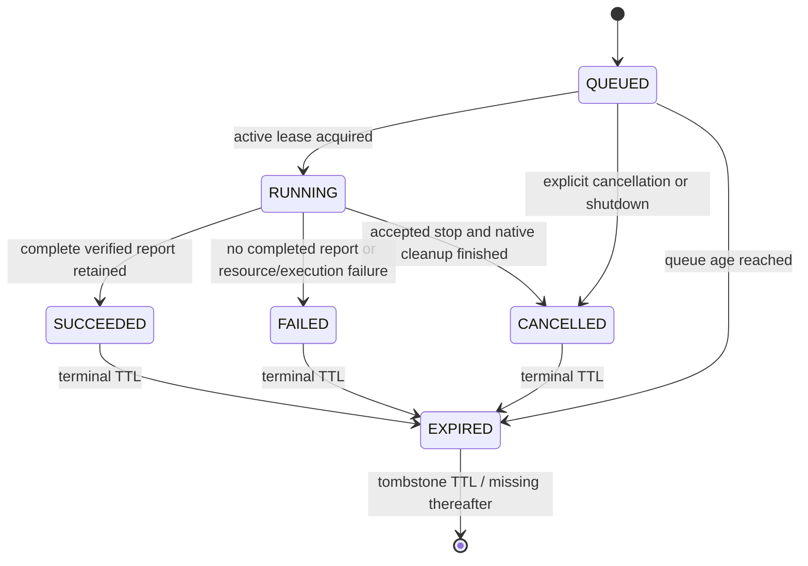

# M05B: Bounded asynchronous optimization jobs

The existing loopback API now owns a small in-memory job lifecycle for synthetic
scheduling and what-if optimization. Clients submit, poll, retrieve verified results
and explicitly cancel managed native work. No database, distributed worker, durable
queue, deployment, ML serving or M06 functionality is introduced. See
[ADR 0014](../decisions/0014-bounded-local-optimization-jobs.md) and the preserved
[M05A boundary](api-foundation.md).

## API and transport contracts

Every job endpoint requires the existing configured Bearer token, actual loopback
peer and literal local Host. Existing strict JSON/Decimal parsing, body limits,
unknown-field rejection, request IDs and safe error envelope apply. CORS adds DELETE
to GET/POST for the same explicit local origins; no wildcard/credentialed CORS.
There are no query parameters, artifact paths, caller-selected worker modules,
executables, owner IDs or resource-limit overrides in these request schemas.

| Method/path | Input | Outcome |
| --- | --- | --- |
| POST `/api/v1/jobs/scheduling` | `{"instance": <unchanged M03 input object>}` | 202 and job metadata after bounded validation/admission |
| POST `/api/v1/jobs/scenarios` | `{"baseline": <M03 object>, "specification": <M04 object>}` | 202; greedy or explicitly requested bounded CP-SAT comparison |
| GET `/api/v1/jobs/{job_id}` | None | 200 lifecycle metadata |
| GET `/api/v1/jobs/{job_id}/result` | None | 200 immutable completed result; 409 not ready/failed/cancelled, 410 expired |
| DELETE `/api/v1/jobs/{job_id}` | None | 202 cancellation accepted; 200 unchanged terminal metadata if completion/cancellation/expiry already won |

POST accepts complete JSON objects, with the same numeric input/report-string
distinction as M05A. All transformations learned by ML remain entirely outside this
API. Before admission the existing 256 MiB/5s validation worker checks the closed
envelope, domain contracts, synthetic flag, 32 orders/96 stages, 64 changes, fingerprint
binding and the complete atomic what-if transformation. Malformed/oversized requests
create no job record. Scheduling jobs use the server's fixed seed 42, one worker and
1s wall / 1 deterministic unit **per phase**, with zero optimality gaps.

Scenario specifications preserve M04 semantics. Missing scheduling means greedy.
Explicit `greedy_with_cp_sat` must declare a solver budget within 1s wall and 1
deterministic unit per phase, seed 42, one worker, benchmark mode. Zero budgets are
allowed. M04's omitted wall budget remains 10s: the job API **rejects** it with
JOB_SOLVER_POLICY instead of silently clamping/re-fingerprinting input. An explicit
supported request fragment is:

```json
"scheduling": {
  "method": "greedy_with_cp_sat",
  "solver": {
    "wall_time_seconds_per_phase": 1,
    "deterministic_time_per_phase": 1
  }
}
```

The fragment belongs inside the specification. Existing request files are not edited
by the server or example client; the client modifies only its in-memory request copy.
POST returns a cryptographically random 32-hex-character job ID, a relative
`Location` polling URL and Retry-After 1. Public metadata has:

| Field | Meaning |
| --- | --- |
| `job_id`, `job_type` | Opaque 128-bit ID, type scheduling/scenarios |
| `status`, `phase` | Lifecycle and genuinely observed execution stage |
| `submitted_at`, `started_at`, `completed_at` | Actual UTC aware timestamps; absent events are null |
| `expires_at` | Nominal UTC retention/tombstone deadline; expiry itself uses monotonic age |
| `cancellation_requested`, `cancellation_available` | Stop flag and whether another stop can still affect nonterminal work |
| `result_available` | True only for a succeeded, retained result |
| `error_code` | Safe machine category on failure/queue expiry, otherwise null |
| `polling_url`, `result_url` | Relative authenticated URLs |

All replies retain `{api_version, request_id, data}` or the existing error envelope.
The HTTP request ID also appears in X-Request-ID; each poll/result request gets its
own ID. Cache-Control no-store applies. OpenAPI at `/api/v1/openapi.json` documents
closed input and typed metadata/result schemas; `/api/v1/docs` stays fully local.

## Lifecycle, ownership and races



An idle registry reserves the active lease immediately at admission and reports
RUNNING/STARTING_WORKER; it need not first publish QUEUED. Other admitted jobs wait
FIFO. WORKER_RUNNING means the outer process has its resource guard and was released;
it does not claim a particular CP-SAT phase or percentage progress. A running stop
retains RUNNING with phase CLEANING_UP until actual cleanup completes. Terminal phases
are TERMINAL or EXPIRED.

One condition lock orders admission and terminal publication. Cancellation accepted
before publication wins, including when a result is already buffered; it is discarded
and cannot later become SUCCEEDED. Completion published first remains SUCCEEDED and
retains its result. Repeated DELETE is idempotent and never erases a terminal result.
Queued cancellation removes the entry from execution immediately. A timed-out native
worker cannot publish later. No active lease/result reservation is released before
the guard has terminated/drained managed work.

All jobs belong to this application lifetime and the one authenticated local user.
Any holder of the configured token can inspect/cancel any job; there is no tenant
separation. IDs are not credentials. Headers/token values are not stored in records.
A disconnected submitting/polling client does not cancel admitted work; DELETE is
explicit. A lost POST response can leave an admitted job whose ID the client did
not receive. There is no automatic retry/idempotency or job-list endpoint; storage,
runtime and expiration still bound the work. Retrying POST can create another job.

## Admission, resources and cleanup

| Dimension | Fixed default / maximum |
| --- | ---: |
| Background supervisors / active jobs | 1 fixed thread / 1 job |
| Waiting capacity | 2 FIFO entries |
| Stored records | 32, including terminal/tombstones |
| Encoded result per job | 2MiB |
| Retained plus reserved result bytes | 8MiB |
| Terminal retention | 300s |
| EXPIRED tombstone retention | 300s |
| Queue age | 30s; then EXPIRED without execution |
| Whole-job watchdog | 15s |
| Outer Windows job memory | 768MiB aggregate commit |
| Inner native optimizer | 512MiB;5s whole-child watchdog |
| Native solver phases | seed 42, worker 1, 1s wall / 1 internal deterministic unit each |
| Native dimensions | 96 operations, 2,000 alternatives, 6,000 variables, 15,000 constraints |
| M05A budgets | unchanged: 2 admitted request slots, 256 KiB body, 2 MiB response, 256 MiB/5s child |

Admission atomically reserves a full 2 MiB result allowance as well as a registry and
execution/waiting slot. Retained actual bytes plus all reservations never exceed 8 MiB.
Success exchanges its reservation for actual encoded bytes; failure/cancellation/queue
expiry releases the reservation. Request bodies are discarded at terminal completion.
The registry never evicts active/waiting work or an unexpired result to admit another
job. A full queue/registry/result budget returns 429. An EXPIRED tombstone disappears
after its deadline; arbitrary/missing/previous-server IDs then return 404.

TTL maintenance runs at fixed idle supervisor wakeups and lazily on API operations.
Terminal results are discarded after 300s and become EXPIRED; metadata remains for
another 300s. Queue expiry enters EXPIRED immediately and retains its tombstone for
300s. Metadata/result quotas are for registry retention, not total Python RSS or
temporary transport buffers. The supported server still bounds connections/tasks
to 32, keepalive 5s and backlog 32.

Job submissions use M05A's existing two bounded HTTP/body-validation slots only until
admission. Background work uses its separate fixed supervisor/process lease, so a
long job cannot consume a synchronous execution slot. Polling/health are cheap
metadata paths. Native solving never runs on the event loop. This policy reserves
admission capacity, not dedicated CPU cores or a cross-machine latency guarantee.

Each whole job runs in an outer guarded process and invokes unchanged M04/M03B code.
M04 may start one guarded native child at a time; a scenario runs its two attempts
serially. Windows uses a suspended launcher attached to an outer kill-on-close Job
Object with at most four processes: two launcher/interpreter pairs. Existing inner
guards retain two-process limits and named-job membership checks. Closing the outer
job stops its native descendants too. Linux starts the outer worker in a new session
and kills the whole process group on cancellation/watchdog; RLIMIT_AS remains a
**per-process address-space** bound, at most 768+512=1280 MiB across the two interpreters,
not a claimed 768 MiB aggregate RSS measurement. Unsupported guards fail closed.

Cancellation is polled by the parent guard at 50ms intervals and checks before work
release. Native startup, imports, parsing, engine work and encoding belong to the
supervised job. OS process creation/termination latency cannot always be interrupted;
the watchdog/cleanup policy is not an exact HTTP latency SLA. Normal lifespan shutdown
closes admission, cancels queued/active work, waits for native cleanup and joins the
supervisor. Importing the app starts no thread; ASGI hosts/tests must run lifespan.
After a restart all records disappear. Abrupt-crash orphan recovery, particularly on
Linux, is not guaranteed; no durable-job or recovery claim is made. Only one process
without reload, public hosting, reverse proxy or multiple workers is supported.

## Verification, proof and failures

M03C's small family proved all 18 one-second runs, while medium one-second outcomes
included six missing incumbents and five losses to greedy; large outcomes were mostly
UNKNOWN. That supports the conservative 1s defaults and keeping strict-better selection,
not a production scalability claim or assumption that CP-SAT always improves results.
See the [actual M03C report](../experiments/M03C-solver-scalability.md).

Results retain whole-stage-minute-v1, source/specification/demand fingerprints,
synthetic assumptions/provenance, greedy and candidate schedules, independently
recomputed metrics/objectives, proof phases, producer identity, fallback reason and
limitations. Scheduling job results contain `evaluation`, selected `objectives` and
runtime; scenario results retain M04's original comparison structure. A result reply
has `data={job_id, job_type, result, execution}`. `execution` reports measured outer
wall time/Windows peak commit and the guard backend, without native PIDs/job names.

SUCCEEDED means the job completed with an accepted report; it does not mean CP-SAT
was selected or proved optimal. Only a strictly better independently verified
candidate replaces greedy. Ties/worse/no-incumbent/invalid evidence or an inner
watchdog/worker failure retain M04's verified greedy and explicit reason. Proof
belongs to its producer; do not transfer a tied candidate's proof to selected greedy.
FEASIBLE does not become OPTIMAL. First UNKNOWN has no invented candidate/metrics;
later UNKNOWN can retain only a real previously verified incumbent.

If the whole-job process is cancelled or stopped before a complete report reaches
the parent, the job has no retrievable result. Cancellation becomes CANCELLED;
whole-job timeout becomes FAILED/EXECUTION_TIMEOUT. No partial/fabricated schedule is
substituted. Independent verification already gates the unchanged engine output.
Raw native stderr, exception messages and diagnostic paths are sanitized at the API
boundary; public codes/proof/objective/verification/provenance remain explicit.

| Situation | Public response |
| --- | --- |
| Malformed/unknown/oversized request | Existing 400/413/415/422 envelope; no record |
| Unsupported solver settings | 422 JOB_SOLVER_POLICY; no silent clamping |
| Sync preparation slots full | 429 SERVER_BUSY |
| Job queue / registry / reserved-result budget full | 429 JOB_QUEUE_FULL / JOB_REGISTRY_FULL / JOB_RESULT_CAPACITY |
| Lifespan absent or shutting down | 503 JOB_SERVICE_UNAVAILABLE |
| Unknown job ID | 404 JOB_NOT_FOUND |
| Result before completion | 409 JOB_NOT_READY |
| Result of failed/cancelled job | 409 JOB_FAILED / JOB_CANCELLED, safe category only |
| Expired retained result | 410 JOB_EXPIRED; status remains readable until tombstone expiry |
| Whole-job timeout, unavailable guard, failed worker, oversized report | Status 200 with FAILED and safe EXECUTION_TIMEOUT / RESOURCE_GUARD_UNAVAILABLE / EXECUTION_FAILED / RESPONSE_LIMIT_EXCEEDED |

An outer OS memory kill without a structured receipt can surface as EXECUTION_FAILED.
Resource stops/UNKNOWN do not prove mathematical infeasibility. Cancellation status
is never labelled a feasible or optimal result.

## Local reproduction and worked HTTP workflow

Use the existing pinned M05A/optimization environment; no dependency was added:

```powershell
.\.venv\Scripts\python.exe -m pip install -r requirements/m05a.txt
.\.venv\Scripts\python.exe -m pip install --no-deps -e ".[dev,ml,optimization,api]"
$env:LOOMETRIC_API_TOKEN = & .\.venv\Scripts\python.exe -c "import secrets; print(secrets.token_urlsafe(32))"
.\.venv\Scripts\python.exe -m loometric.api
```

In a second terminal with the same securely configured token/optional
LOOMETRIC_API_PORT, run:

```powershell
.\.venv\Scripts\python.exe examples/api/jobs_workflow.py
```

The [client](../../examples/api/jobs_workflow.py) submits scheduling, polls, retrieves
the verified report, submits the routing what-if comparison with explicit 1s budgets,
and submits/deletes a further job. It handles a completion-before-cancellation race
without erasing success. Credentials are never printed; proxy-environment trust and
redirects are disabled. The self-contained test starts a real server on an ephemeral
loopback port, runs the client twice and stops it:

```powershell
.\.venv\Scripts\python.exe -m pytest tests/api/test_job_live.py -q
.\.venv\Scripts\python.exe -m pytest tests/api -q
.\.venv\Scripts\python.exe -m pytest -q
.\.venv\Scripts\python.exe -m ruff check .
.\.venv\Scripts\python.exe -m ruff format --check .
.\.venv\Scripts\python.exe -m pip check
```

In the worked routing input the baseline already finishes 28 units. Added hypothetical
capacity makes greedy finish 18 in the modified input; CP-SAT recovers 28 there with
three proven objectives. The selected baseline-versus-scenario relation is TIE, not
a causal capacity/productivity improvement. All inputs and outcomes are synthetic.
Job IDs/timestamps/timing change between runs; no bitwise native wall-limit guarantee
or statistical significance is claimed.

## Measured checks and remaining limits

Final checks on Python 3.13.14 / Windows x86-64:

| Check | Actual outcome |
| --- | --- |
| Full `pytest -q` | 940 passed in 143.74s; no skips/failures |
| API subset included in full run | 117 tests, including 41 new M05B cases |
| Earlier complete API run | 115 passed in 50.20s before the final client/isolation additions |
| Ruff lint / format | Passed; 185 files already formatted |
| `pip check` / installed pins | Clean; all 39 prior pins match, no new dependency |
| Local wheel build/inspection | Passed; both limit JSONs and job worker included |
| Protected old-source comparison | 197 files byte-identical; 12 intentional transport/resource/docs/test changes |
| Local documentation links | 47 targets resolve |
| Native PID observation | CP-SAT process stopped before terminal publication/capacity release for cancel and shutdown |
| Native allocation fault | Controlled 2 GiB allocation under the real hard cap produced verified greedy fallback |
| Real loopback client | Two complete runs; both explicit cancellation samples CANCELLED |

The latest two live-client samples measured the whole outer process, including
imports, nested solving, verification and serialization:

| Run | Scheduling wall s | Scheduling peak commit MiB | Scenario wall s | Scenario peak commit MiB |
| --- | ---: | ---: | ---: | ---: |
| 1 | 1.6326 | 432.1719 | 2.8851 | 433.1172 |
| 2 | 1.8691 | 432.9102 | 2.6193 | 433.0820 |

Scheduling selected CP-SAT with OPTIMAL and three proven levels. Its selected
objective tuple was (unfinished 6, weighted tardiness 1460, makespan 10). The routing
scenario selected 28 versus same-instance greedy 18 units with three levels proved;
its selected comparison against the original 28-unit baseline remained TIE.
Native in-flight cancellation and normal registry shutdown took 0.0381s and 0.0078s
respectively from stop request to terminal/PID-stopped observation. These are local
single samples on the existing host, not latency SLAs or general scaling evidence.
The phase-observation hook changes no solver result; allocation failure, FEASIBLE,
startup delay, worker timeout receipts and clock advancement are explicitly controlled
fault injections, not naturally observed benchmark outcomes. Full retention/queue
expiry is tested through a monotonic test clock rather than waiting five minutes.

Initial development failures were a new receipt test expecting a domain error for
an empty outer envelope, and three tests assuming a fixture had explicit solver
settings. Expectations/request copies were corrected; the fixture and M04 defaults
remain unchanged. Routine lint findings were fixed before verified commits. There
is no unresolved test failure, new ML result or production-readiness claim.

Tests cover authentication/all endpoints, invalid input, atomic admission, quota and
queue rejection, FIFO/expiration, cancellation before/during startup and native
execution, completion races, idempotent terminal DELETE, memory guard behavior,
watchdog termination, retention/restart, shutdown join, independent verification,
proof/objective consistency and M05A preservation. Native UNKNOWN/OPTIMAL examples
are distinguished from explicitly injected FEASIBLE/worker failure/clock/memory fault
cases. A fresh-process audit applies to the API probe and all actual native children
and denies protected ML data/loader/artifact access. Full legacy ML/CLI tests remain.

This is a local shared-token API with volatile bounded storage, no tenant identity,
durability, idempotent submission, crash recovery or operational factory validation.
Linux resource behavior has not been independently exercised on this Windows host.
M06 needs a separate product/contract decision; it is not started by this milestone.
