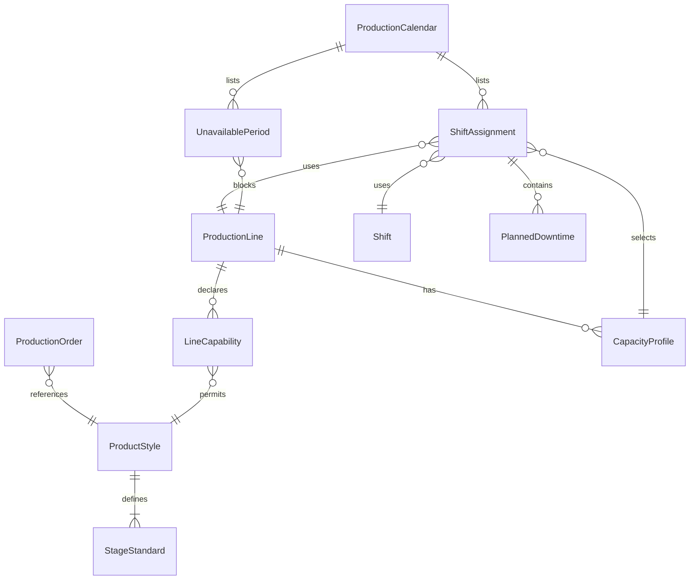

# M02: Production planning data foundation

M02 is a standalone, deterministic **capacity assessment**, independent of ML.
The executable examples are entirely synthetic and establish no factory performance
or operational readiness. Orders are assessed independently; no capacity is reserved,
no schedule is constructed and global feasibility is **NOT_ASSESSED**.
See [ADR 0008](../decisions/0008-independent-planning-capacity-foundation.md).

## Architecture and entity relationships

| Module | Responsibility |
| --- | --- |
| `planning/domain.py` | Immutable validated entities, units, interval semantics and evidence status |
| `planning/validation.py` | Typed validation primitives and `PlanningError` reason codes |
| `planning/scenario.py` | Aggregate referential integrity, capabilities and calendar constraints |
| `planning/availability.py` | UTC interval unions and shift availability without double subtraction |
| `planning/capacity.py` | Labor/capacity formulas and independent order/stage/slot assessments |
| `planning/loading.py` | Strict versioned scenario JSON, explicit dates/offsets and decimal parsing |
| `planning/reporting.py` | Stable JSON-compatible output and decimal strings |
| `planning/cli.py`, `__main__.py` | Local synthetic scenario assessment and structured errors |



| Entity | Contract |
| --- | --- |
| `ProductionOrder` | Unique order ID, style reference, positive integer quantity/priority, release/due dates, ordered required stages. Priority 1 is highest; no priority allocation occurs. |
| `ProductStyle` | Style ID, output unit `piece`, one positive `StageStandard` per eligible stage. Eligibility is derived from these standards. |
| `StageStandard` | Stage and positive standard **worker-minutes per piece**, with explicit `worker_minutes_per_piece` unit. |
| `ProductionLine` | Line ID, stage, nonnegative integer worker count and `available`/`unavailable` status. Zero workers is valid zero capacity. |
| `LineCapability` | Exact line/style/stage binding plus required `workforce_basis` explaining the crew capability assumption. No unrestricted default capability. |
| `Shift` | Shift ID, positive aware start/end interval, explicit contained, non-overlapping break intervals. Break duration and working minutes are derived. |
| `ProductionCalendar` | Calendar ID, explicit working dates, assignments, planned downtime and line unavailability. No guessed weekly schedule. |
| `ShiftAssignment` | Assignment ID and explicit line, shift and profile references. |
| `CapacityProfile` | Profile ID, line, effective date, assumed efficiency, source ID, synthetic/verified status and optional evidence reference. |
| `PlannedDowntime` | Downtime ID, assignment reference, contained nonnegative interval and reason. |
| `UnavailablePeriod` | Period ID, line reference, nonnegative interval and reason; may span multiple shifts. |

`PlanningScenario` is the validated aggregate. Identifiers are unique within each
entity collection; cross-entity reuse does not merge identities. Canonical strings
must be nonblank without surrounding whitespace/control characters. In-process
constructors require typed enums, dates, Decimal values and immutable tuples.
No repositories, factories, framework interfaces or new dependencies are introduced.

## Units and assumptions

Quantity is an integer number of **pieces**. Elapsed minutes describe clock duration;
worker-minutes describe labor, and standard worker-minutes describe work content
under the supplied standards. A four-person crew over 450 elapsed minutes offers
1,800 worker-minutes, not 450 worker-minutes or 1,800 elapsed minutes.

Each declared line crew is dedicated during its assignment. `LineCapability` must
state why that crew is assumed able to perform the exact style/stage. The simple
labor-pool formula assumes additive qualified labor **only within that declared
capability**. It does not infer interchangeable workers across lines, styles or
departments. Shared workers, individual skills, role bottlenecks, machine rates,
attendance changes and staffing transfers are unsupported, not silently resolved.

Efficiency is an explicit capacity-derating fraction in **[0,1]**, not an estimate
from the historical CSV or a productivity forecast. Zero is a supported degenerate
case. This bounded derating convention does not redefine M01's target, whose values
can exceed one. Standards and efficiency are uncalibrated synthetic inputs here.

A selected profile must belong to its line and be effective by the shift's start
date. Selection is explicit: the engine does not infer a latest profile, freshness
SLA or expiry. `verified` requires an evidence reference in the domain; it remains a
caller assertion, not software certification. Synthetic scenarios must label every
profile synthetic, and the M02 CLI rejects `synthetic=false` scenarios.

## Calendar, breaks and downtime

Intervals are half-open `[start,end)` and comparisons/durations use UTC instants.
Timestamp offsets are explicit. Adjacent assignments on a line are valid; overlapping
ones are errors even when represented using different timezone offsets. A shift
requires positive duration; downtime/unavailability may have zero duration.

The local date of the shift's **start** determines its calendar working date and
profile effective-date check. An overnight shift belongs to that date. For example,
the synthetic evening shift starts January 7 and ends at January 8 midnight; January
7 is the explicit working date. Offsets are caller supplied; there is no inferred
factory timezone, recurring IANA/DST calendar, holiday rule, maximum shift length or
overtime policy. Callers must supply a consistent production-calendar interpretation.

Breaks must have positions, not just a total duration. An aggregate 30-minute break
cannot establish whether it overlaps downtime. Breaks must lie within the shift and
cannot overlap one another; adjacent breaks are accepted. `Shift.break_minutes`
and `Shift.effective_working_minutes` describe the shift after breaks **before**
planned downtime, unavailability, crew size or efficiency.

Planned downtime must lie completely within its referenced assignment's shift.
Unavailable periods are line-wide: intersect them with each shift, allowing periods
to span several assignments or lie outside the assessed horizon. An unavailable
line blocks the entire shift. Union all excluded intervals before subtraction:

1. Breaks contribute `break_minutes`.
2. Planned stoppages contribute only time not already covered by breaks:
   `planned_downtime_additional_minutes`.
3. Unavailability contributes only time not covered by either:
   `unavailable_additional_minutes`.

These increments sum to `blocked_union_minutes`. Their attribution order is fixed
bookkeeping, not causal evidence. Overlapping stoppage reasons remain in the input;
their elapsed time is counted once. Durations are accumulated as exact timedeltas
before decimal conversion, including microsecond break partitions.

## Capacity formulas

For a particular compatible line, stage and shift, define:

| Symbol | Meaning / unit |
| --- | --- |
| G | Gross shift elapsed minutes |
| B | Duration of the union of breaks, planned downtime and unavailability inside the shift |
| M = G − B | Available elapsed minutes |
| W | Dedicated workers for that line |
| E | Declared efficiency fraction |
| S | Stage-specific standard worker-minutes per piece |
| Q | Target pieces for the order/stage |

| Output | Formula | Unit |
| --- | --- | --- |
| Available labor A | M × W | worker-minutes |
| Effective capacity C | A × E | standard worker-minutes |
| Stage demand R | Q × S | standard worker-minutes |
| Potential pieces | floor(C / S) | whole pieces |
| Required raw labor | R / E, when E > 0 | worker-minutes |
| Standard-minute shortfall | max(0, R − C) | standard worker-minutes |
| Raw labor shortfall | max(0, R / E − A), when E > 0 | worker-minutes |
| Total order work content | Sum of R for **that order's required stages only** | standard worker-minutes, never elapsed completion time |

At zero efficiency, potential output is zero and required raw labor/its shortfall
are null: there is no finite labor solution under that assumption. No division by
zero, Infinity or fabricated finite requirement is returned. No efficiency default
or ML-to-capacity conversion exists. For incompatible slots, potential pieces,
labor requirements, capacity shortfalls and `capacity_sufficient` are null; stage
demand remains defined. A different line's labor is not treated as usable.

Arithmetic uses a fixed **28-significant-digit Decimal context**. Durations and
finite products/divisions are represented at that precision; repeating ratios are
rounded by that declared arithmetic convention. Flooring uses an exact rational
comparison of the computed decimal capacity and stage standard. Outputs encode
Decimal values as canonical decimal **strings**, quantities as JSON integers and
flags as booleans. Input JSON numbers are parsed directly as Decimal, avoiding a
binary-float intermediate. No automatic unit conversion or input rounding is applied.
The report explicitly names piece, elapsed-minute, worker-minute and standard
worker-minute units. It contains no clock/runtime metadata.

## Independent feasibility and multi-stage scope

`required_stages` is each order's ordered precedence chain; supported stage names
are cutting, sewing, finishing, quality_control and packing. Orders need not share
the same stages or sequence. All required stages must have style standards. Repeated
visits, alternate routes, yields, rework and stage-specific quantities are unsupported.
Each required stage is assessed for the full order quantity.

For every order/required-stage and every unique assignment, return a row containing
compatibility, stage demand, potential output, shortfalls and reason codes. Compatible
means an exact declared line/style/stage capability exists. Availability, date window
and capacity are separate checks. Sorting IDs stabilizes reporting; it is not a
dispatching rule or a scheduler.

`independent_slot_feasible` requires compatibility, an available crew/time slot,
positive efficiency, enough pieces and the **entire** slot inside the order's date
window. Release and due dates use the shift start's local timezone interpretation.
Due dates include that complete local day: ending exactly at next midnight is allowed.
A slot extending outside the window fails conservatively; the engine does not infer
earlier completion or partial-slot allocation.

The summary `all_stages_have_independent_slot` states only that every stage has at
least one individually sufficient slot. Those slots may overlap or violate the
declared stage sequence if naively combined. The engine does not select or reserve
them. Multiple orders can identify the same slot because each is a separate
hypothetical assessment; no capacity is duplicated in the unique `slots` inventory
or summed as an allocation. Every report includes:

```json
{
  "assessment_scope": "INDEPENDENT_ORDER_STAGE_SLOT",
  "allocation_performed": false,
  "schedule_feasibility": "NOT_ASSESSED"
}
```

No sufficient single slot does not prove an order impossible over the whole horizon:
split production or a different future schedule could change that conclusion.
Conversely, individually sufficient stages do not prove a feasible route or plan.
WIP, materials, transfers, setup/changeover, preemption, shared resources and
cross-order competition are deferred to explicit M03 design.

## Validation and reason codes

The versioned JSON requires all declared fields, except optional profile
`evidence_reference`. Empty `breaks`, downtime, unavailability and assignment lists
are explicit, not inferred defaults. Unknown fields, missing references, duplicate
keys/IDs, NaN/Infinity, unsupported units, invalid enums, fractional/bool counts,
nonpositive standards/quantities and invalid date/timestamp formats are rejected.
Date format is `YYYY-MM-DD`; timestamps require seconds and `Z` or `±HH:MM`, optionally
up to six fractional second digits. No stripping, guessing, imputation or repair.

Representative validation codes are INVALID_FIELDS, INVALID_INTEGER,
INVALID_DECIMAL, INVALID_TIMESTAMP, UNSUPPORTED_UNIT, UNKNOWN_REFERENCE,
DUPLICATE_IDENTIFIER, CAPABILITY_STAGE_MISMATCH, PROFILE_LINE_MISMATCH,
PROFILE_NOT_EFFECTIVE, NONWORKING_DATE, OVERLAPPING_ASSIGNMENTS,
BREAK_OUTSIDE_SHIFT and DOWNTIME_OUTSIDE_SHIFT. Errors have structured code/message.

Assessment reasons include STAGE_MISMATCH, STYLE_NOT_SUPPORTED, LINE_UNAVAILABLE,
NO_WORKERS, NO_WORKING_TIME, ZERO_EFFICIENCY, BEFORE_RELEASE_DATE,
AFTER_DUE_DATE and INSUFFICIENT_CAPACITY. Stage summaries distinguish
NO_CALENDAR_ASSIGNMENTS, NO_COMPATIBLE_SLOT and NO_SUFFICIENT_INDEPENDENT_SLOT.
Such an assessment is a successful calculation, not an input-validation failure.

## Executable synthetic examples and measured results

From the repository root using the existing local installation:

```powershell
.\.venv\Scripts\python.exe -m loometric.planning `
  --scenario examples/planning/capacity-demo.json

.\.venv\Scripts\python.exe -m loometric.planning `
  --scenario examples/planning/invalid-quantity.json
```

The [complete scenario](../../examples/planning/capacity-demo.json) contains six orders,
five lines and six assignments across two shifts. It uses hypothetical crews,
standards, efficiencies and +03:00 offsets; these are not real factory records.
No raw CSV, frozen ML split, M01 artifact, network or ML package is read/imported.
The [invalid example](../../examples/planning/invalid-quantity.json) demonstrates
quantity zero rejection with INVALID_INTEGER and exit code 2.

The complete CLI returns exit 0 and **42 stage/slot assessments**. Selected
compatible slot results from the actual run are:

| Assignment | Style/stage | Available elapsed min | Worker-min | Effective standard min | Potential pieces |
| --- | --- | ---: | ---: | ---: | ---: |
| A-DAY-SEW-01 | TEE / sewing | 360 | 1440 | 1152 | 96 |
| A-EVE-SEW-01 | TEE / sewing | 450 | 1800 | 1440 | 120 |
| A-DAY-FIN-01 | TEE / finishing | 450 | 900 | 810 | 202 |
| A-DAY-SEW-B | STYLE-B / sewing | 450 | 1350 | 1012.5 | 50 |
| A-DAY-SEW-ZERO | TEE / sewing, zero crew | 450 | 0 | 0 | 0 |
| A-DAY-SEW-OFF | TEE / sewing, unavailable | 0 | 0 | 0 | 0 |

Day sewing has 480 gross minutes. Lunch is 12:00–12:30; planned stops
11:30–12:30 and 12:15–13:00 union to 90 minutes, of which only 60 are additional
to lunch. Unavailability 12:45–13:30 adds another 30 minutes. Total blocked time
is **120**, leaving **360**, rather than subtracting all reasons independently.

| Independent order check | Measured result |
| --- | --- |
| O-NORMAL: 100 TEE sewing pieces | Evening sufficient; day short by 48 standard minutes (60 raw worker-minutes). |
| O-SMALL: 80 TEE sewing pieces | Day and evening each sufficient independently. |
| O-LARGE: 200 TEE sewing pieces | No sufficient single slot; evening short by 960 standard minutes. Horizon/split-order feasibility is not assessed. |
| O-MULTI: 50 TEE sewing → finishing pieces | Both stages have individually sufficient slots; stage sequencing is not established. |
| O-STYLE-B: 40 STYLE-B sewing pieces | Only SEW-B has the required capability; other sewing lines report STYLE_NOT_SUPPORTED. |
| O-QC: 10 TEE quality-control pieces | NO_COMPATIBLE_SLOT: the style has a QC standard but no QC line is declared. |

The output includes the assumptions, profile source/evidence labels, workforce
capability basis, unique slot inventory, per-stage diagnostics and order summaries.
Raw JSON is generated locally; it is not versioned as a result artifact. CLI syntax
errors use argparse exit 2; unreadable/invalid scenarios produce INVALID_SCENARIO
JSON with exit 2. Infeasible independent assessments still return CAPACITY_ASSESSED
with exit 0; that exit code never approves a production plan.

## Actual verification

- Full pytest: **483 passed in 49.42 s**: 352 existing cases plus 131 new planning cases.
- Ruff lint and formatting checks pass; `pip check` reports no broken requirements.
- All **18 existing exact dependency pins** match; no package or ignore-rule changes.
- Two final complete synthetic runs produce byte-identical Windows stdout JSON
  (38,592 bytes, CRLF), SHA-256
  `33dc34597463f63557cde5c6aa73a12fa23ba0cbdffa52859b7a4933e338fd8a`.
  Text line endings can differ on another platform; the compared bytes use the
  recorded Windows environment, and all report values/order are deterministic.
- **57 existing source/document/config/local-artifact hashes** remain unchanged.
  Protected targets are not consumed by M02; earlier evaluation boundaries remain intact.
- Tests cover entity/unit validation, chronology, references/capabilities, profiles,
  union arithmetic, exact boundary counts, zero capacity, microsecond break partitions,
  order independence, multi-stage definitions, deterministic reports and strict JSON.
- A separate `python -S` process runs the example with site packages excluded,
  forbids data/prediction file opens and verifies no pandas/sklearn/joblib or M01/data
  modules were imported. Another test permits only the explicitly requested scenario read.

No pytest failures occurred. Routine Ruff import/line-format findings were corrected
before verification. Type hints are present; no static type checker is configured.
These are software checks and synthetic arithmetic results, not operational validation.

## M01 boundary and future M03 requirements

M01 remains an experimental prediction interface; it does not supply capacity
efficiency or validate standards. M02 imports none of its modules or artifacts and
changes none of its contracts, experiments or reserved data. Any later bridge needs
verified productivity units, grain, planning-to-team/line mappings, prediction-time
availability, source evidence and explicit review/abstention semantics first.

Before future OR-Tools work, define the scheduling instance and a deterministic
reference dispatcher on identical constraints: capacity reservations across orders,
route precedence and WIP availability, release/due semantics, splitting/preemption,
setup times, material readiness, worker/machine compatibility, objective components,
time discretization and rounding rules. Specify how a verifier detects resource
overlap, precedence violations and lateness independently of the solver. Derate labor
and convert to elapsed duration only under documented crew/stage assumptions.
Compare any later optimizer with that same-instance reference; do not infer optimality
from M02's capacity arithmetic. M03 and all scheduling/optimization work remain unstarted.
