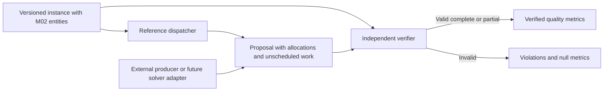

# M03A: Scheduling contract, verifier and reference dispatcher

The scheduling policy is **whole-stage-minute-v1**, frozen before implementation
and benchmark execution in [ADR 0009](../decisions/0009-reference-scheduling-policy.md).
All examples are synthetic. No OR-Tools, ML capacity conversion, API, database or
frontend is introduced. M01 and M02 retain their existing behavior.

## Frozen supported subset

Version-1 instances embed M02 planning entities, an explicit scheduling horizon,
fixed calendar UTC offset and exactly one-minute allocation granularity. All time
boundaries align to UTC minutes; shift starts use the declared calendar offset.
Orders supply their own ordered stages and stage-specific worker-minutes per piece.

Whole order/stage quantities are processed nonpreemptively on one compatible line,
using its complete declared crew, within one uninterrupted working interval of one
shift. Partial use of a shift is allowed. Operations cannot span breaks, downtime,
unavailability or shifts; splitting, rework, WIP, setups, shared crews and materials
are unsupported. Unsupported large operations remain explicitly unscheduled.

Duration is ceil(quantity*stage_standard/(workers*efficiency)) elapsed minutes using
exact rational arithmetic. The whole rounded interval's worker-minutes and effective
standard-minute capacity are reserved. Predecessors finish before successors start.
Release dates are hard local-midnight bounds. Due dates are soft next-midnight
deadlines, permitting measurable late completions inside the horizon. This refines
timed scheduling without changing M02's independent full-slot assessment.

The reference ranks priority, due date, order ID; each stage takes the earliest
feasible gap, breaking ties by finish time and stable resource IDs. It reserves
capacity before continuing. Every stage is allocated or explicitly unscheduled;
partial upstream work remains visible. There is no global optimality claim.

An independent verifier gates all quality metrics. Finished units count only fully
scheduled orders; incomplete orders retain their full unscheduled finished-goods
quantity. Tardiness covers completed orders only. Priority weights are
max(instance priorities)+1-priority. Makespan is measured from horizon start.
Utilization and unused capacity use declared available resources inside the horizon.

## Modules and public interfaces

| Module | Responsibility |
| --- | --- |
| `scheduling/contracts.py` | Versioned instance, allocations, explicit unscheduled work and input identity |
| `scheduling/resources.py` | Recomputed eligible slots, working fragments and exact processing requirements |
| `scheduling/dispatcher.py` | `dispatch(instance)`; serial priority/due/ID reference with finite line reservations |
| `scheduling/verification.py` | `verify_schedule(instance, proposal)`; accepts any producer's typed proposal |
| `scheduling/metrics.py` | `calculate_metrics(instance, proposal)`; independently re-verifies feasibility |
| `scheduling/loading.py` | Strict instance/proposal JSON using existing M02 parsing/domain construction |
| `scheduling/cli.py`, `__main__.py` | Local dispatch/verify commands and deterministic JSON |



M02 retains its existing entity and CLI contracts. Shared extensions expose interval
merging/complements, JSON-compatible values and strict JSON/object construction;
they do not change the original capacity report. No interface/factory framework,
runtime dependency, solver, service or persistent store is added.

## Instance and result schemas

Every instance JSON field is explicit:

| Field | Meaning |
| --- | --- |
| `schema_version` | Integer 1, booleans rejected |
| `policy_version` | Exact `whole-stage-minute-v1` |
| `instance_id` | Stable canonical identifier |
| `planning` | Complete M02 schema-version-1 scenario with orders, stage standards, capabilities, crews, profiles and calendars |
| `horizon` | Positive aware `start`/`end` interval |
| `calendar_utc_offset_minutes` | Fixed calendar offset, e.g. 180 in the synthetic examples |
| `allocation_granularity_minutes` | Integer 1; other granularities are unsupported |

The instance reuses M02 validation for unique IDs, referential integrity, positive
quantities/standards, profile evidence and calendar consistency. Working-date and
effective-profile semantics remain those of the shift start. All input interval
boundaries, including calendar interruptions, must align to UTC minutes; shift start
offsets must match the declared calendar. No recurrent timezone/DST rules are inferred.

Stage processing requirements are explicit through quantity, style stage labor
standard, selected assignment's crew and efficiency. There is no independent duration
override that can contradict them. For each eligible assignment the public static
helper computes an exact rational ratio and its ceiling, with no float intermediate.

Proposed schedules contain `schema_version`, `policy_version`, `instance_id`,
`instance_fingerprint`, `allocations` and `unscheduled`. Each allocation reports
order/stage, assignment/line/shift/profile IDs, aware interval, full quantity, required
standard minutes, consumed worker-minutes and consumed standard-minute capacity.
Unscheduled entries report order/stage, full quantity and a defined reason code.
Every required stage must appear **exactly once** in those two collections together.

Input M02 standards/efficiencies are JSON numbers. Proposal labor/capacity claims use
nonnegative decimal **strings**, matching CLI output; no whitespace, exponent form,
NaN or Infinity is accepted in those strings. Counts are JSON integers. Reports
use M02's fixed 28-digit Decimal presentation. Exact rational calculations determine
duration and metric arithmetic before presentation. Calendar times stay explicit;
reference allocations and computed completion timestamps are emitted in UTC.

Fingerprints hash sorted compact UTF-8 JSON of the typed instance using the shared
date/decimal representation. They bind all declared metadata, including collection
order; this representation is an identity encoding, not an M02 input serializer.
Changing equivalent collection order may change identity, while dispatch allocations
and metrics remain independent of that order. Fingerprints detect input drift and
do not authenticate a source. A proposal from another instance is invalid.

The CLI wraps the proposal with synthetic assumptions, horizon, algorithm identity,
verification and metrics. These statuses are computed, never trusted from a producer:

| Status | Meaning / exit code |
| --- | --- |
| `VALID_COMPLETE` | Every operation allocated and no violation / 0 |
| `VALID_PARTIAL` | All work accounted for; allocated prefix is feasible, some operations explicitly unscheduled / 0 |
| `INVALID` | Well-formed proposal violates the problem contract / 2; metrics null |
| `INVALID_INPUT` | Missing/unreadable/malformed instance or proposal / 2; metrics null |

All CLI instances must be explicitly synthetic. No execution-clock/runtime metadata
is emitted, and `optimality_claim` is always false. Valid partial means feasibility
of the included allocations; it does not mean that omitted work is impossible.

## Reference dispatch and unscheduled diagnostics

The algorithm is `serial-priority-due-id-v1`:

1. Sort orders by ascending priority, due date and order ID; 1 is highest priority.
2. Visit each order's stages in its declared order. Earliest start is the maximum
   of release, horizon start and predecessor completion.
3. For each compatible positive-capacity assignment, subtract already reserved line
   intervals from its static working fragments. Find its earliest fitting gap.
4. Choose by `(start, finish, line_id, shift_id, assignment_id)` and reserve the
   complete rounded processing interval and crew before continuing.
5. If a stage cannot be placed, report it and every downstream stage explicitly.
   Keep already allocated upstream work visible; there is no rollback/backtracking.

Priority order is an offline serial generation rule, not a simulation clock: a
higher-priority future-release operation can reserve a later slot while another
order subsequently fills an earlier gap. Orders never run before release. Different
orders may overlap only on distinct declared lines; same-order stages cannot overlap.

Reasons are NO_ELIGIBLE_LINE, NO_AVAILABLE_CAPACITY, RELEASE_AFTER_HORIZON,
REQUIRES_SPLITTING_OR_PREEMPTION, HORIZON_EXHAUSTED, CAPACITY_RESERVED and
PREDECESSOR_UNSCHEDULED. Unsupported-size classification checks full static calendar
fragments before clipping to the horizon or applying reservations. The horizon code
means no supported fragment fits after release/predecessor timing within the horizon;
the reservation code means previous reference choices consumed a possible gap.
These labels explain the run, not mathematical infeasibility or optimality.

## Independent verification

The verifier imports no dispatcher and does not require its priority order or its
chosen start times. It rebuilds static slots and requirements from the instance,
not the proposal's claims. It checks:

- Instance identity, required order/stage references and complete one-time accounting.
- Full quantities and compatible assignment/line/shift/profile/style/stage references.
- One-minute boundaries, horizon and single-shift containment, and uninterrupted
  working availability after breaks, planned stops and unavailability.
- Exact rounded processing duration and reported standard demand/raw labor/effective
  capacity. Rounding slack is reserved; it cannot be reused by another operation.
- Actual line overlap in absolute time, hard release and immediate batch precedence.

Representative codes include INSTANCE_MISMATCH, UNKNOWN_OPERATION,
UNREPORTED_OPERATION, DUPLICATE_OPERATION, QUANTITY_MISMATCH, UNKNOWN_ASSIGNMENT,
ASSIGNMENT_REFERENCE_MISMATCH, INCOMPATIBLE_LINE_STAGE, TIME_GRID_VIOLATION,
OUTSIDE_HORIZON, OUTSIDE_SHIFT, UNAVAILABLE_INTERVAL, BEFORE_RELEASE,
ZERO_PROCESSING_CAPACITY, PROCESSING_DURATION_MISMATCH, STANDARD_DEMAND_MISMATCH,
WORKER_MINUTES_MISMATCH, STANDARD_CAPACITY_MISMATCH, RESOURCE_OVERLAP,
MISSING_PREDECESSOR and PRECEDENCE_VIOLATION. Wire-shape/unit errors are rejected
before a typed proposal is verified. Diagnostics identify the operation/assignment.

The verifier accepts feasible nonmaximal partial proposals. It checks the shape and
quantity of unscheduled work, not the truth or optimality of its producer's reason
label. Both public metrics and the CLI gate metrics on independent feasibility.

## Quality metrics and exact aggregation

| Metric | Definition |
| --- | --- |
| Scheduled orders / units | Fully allocated orders only; count each order's quantity once after all its stages are present |
| Unscheduled orders / units | Every incomplete order, including partial prefixes; retain its full finished-goods quantity once |
| Partial orders | Incomplete orders with at least one allocated stage; a subset of unscheduled orders |
| Scheduled/unscheduled operations | Allocated/explicitly unallocated order-stage records |
| Allocated stage units | Sum of allocation quantities across stages; diagnostic work-in-progress measure, not finished goods |
| On-time / late completed orders | Completion at/before the soft deadline versus after it; incomplete orders are neither |
| Total tardiness | Sum of max(0, final-stage completion minus deadline), in elapsed minutes, over completed orders |
| Priority-weighted tardiness | Same sum multiplied by max(instance priorities)+1-order.priority; a declared weight convention, not business cost |
| Makespan | Latest allocated end minus horizon start, in minutes; includes initial idle time and partial upstream work; null when no allocations |
| Line utilization | Occupied line minutes / available calendar working line minutes inside the horizon |
| Unused worker/standard minutes | Available labor/effective capacity minus whole reserved interval consumption |
| Standard-capacity utilization | Consumed standard-minute capacity / available standard-minute capacity |
| Rounding slack | Reserved standard-minute capacity minus exact required standard work for allocated operations |

Resource rows retain assignment, line, shift and stage. Pooled utilization is a ratio
of sums, not a mean of percentages. Available calendar line time can include a line
with zero crew/efficiency; labor and standard-capacity denominators separately show
its inability to process. Thus the limits benchmark has different line and capacity
utilizations. Zero denominators return null, not fabricated zero. Unused capacity in
one stage/resource is not transferable to another merely because units match.

Tardiness scope is explicitly COMPLETED_ORDERS_ONLY. An incomplete schedule with zero
tardiness is not superior to a complete schedule: missing finished goods must be
considered first. No optimum, optimality gap, significance claim or improvement over
an optimizer is calculated in M03A.

## Executable synthetic benchmarks and actual results

```powershell
.\.venv\Scripts\python.exe -m loometric.scheduling dispatch `
  --instance examples/scheduling/competition.json

.\.venv\Scripts\python.exe -m loometric.scheduling verify `
  --instance examples/scheduling/competition.json `
  --schedule examples/scheduling/invalid-overlap.json
```

The `verify` command consumes a proposal object, i.e. the dispatch response's
`schedule` member, not its full report envelope. Deliberately corrupted proposal
files below are intentional test fixtures; generated dispatch reports stay ignored.

| Instance | Complete orders | Incomplete (partial subset) | Finished units | Unfinished units | On-time / late complete |
| --- | ---: | ---: | ---: | ---: | ---: |
| competition | 1 | 1 (0) | 60 | 80 | 1 / 0 |
| parallel-routing | 3 | 0 (0) | 90 | 0 | 1 / 2 |
| calendar-fragments | 2 | 1 (0) | 70 | 80 | 2 / 0 |
| limits | 0 | 6 (1) | 0 | 239 | 0 / 0 |
| zero-capacity | 0 | 1 (0) | 0 | 10 | 0 / 0 |

| Instance | Tardiness min | Weighted tardiness min | Makespan min | Line utilization % | Unused worker-min | Unused standard min |
| --- | ---: | ---: | ---: | ---: | ---: | ---: |
| competition | 0 | 0 | 225 | 46.8750 | 1020 | 816 |
| parallel-routing | 1237 | 1881 | 164 | 21.8750 | 5186 | 4227 |
| calendar-fragments | 0 | 0 | 443 | 73.0556 | 388 | 310.4 |
| limits | 0 | 0 | 75 | 20.8333 | 420 | 336 |
| zero-capacity | 0 | 0 | null | null | 0 | 0 |

Percentages above are rounded for display to four decimal places; JSON retains the
declared 28-digit precision. These different problem instances are not algorithm
performance comparisons. Limits/zero rows have no completed-order tardiness because
they complete no orders, not because their unfinished goods are on time.

The [competition](../../examples/scheduling/competition.json) case is the M02
counterexample: each of its 60- and 80-piece orders independently fits the same
480-minute sewing slot. Their exact durations are 225 and 300 minutes; only A is
reserved, and B reports CAPACITY_RESERVED. Its required 720 standard minutes reserve
900 raw worker-minutes; 816 standard minutes remain, insufficient for B's full batch.

[Parallel routing](../../examples/scheduling/parallel-routing.json) uses two eligible
sewing lines and a finishing line, distinct priorities/deadlines and stage precedence.
[Calendar fragments](../../examples/scheduling/calendar-fragments.json) unions the
M02 overlapping interruptions, leaving 210- and 150-minute fragments. The 80-piece
operation requires 300 uninterrupted minutes, so it is unsupported despite sufficient
aggregate independent M02 capacity. Two smaller operations are allocated.
[Limits](../../examples/scheduling/limits.json) covers an oversized stage, a short
horizon, zero staffing, absent QC capability, a release beyond the horizon and
unfinished upstream work. [Zero capacity](../../examples/scheduling/zero-capacity.json)
has no working resource time or allocations.

The [overlap proposal](../../examples/scheduling/invalid-overlap.json) returns only
RESOURCE_OVERLAP. The [precedence proposal](../../examples/scheduling/invalid-precedence.json),
verified against parallel-routing, returns only PRECEDENCE_VIOLATION. Both return
INVALID, exit 2 and metrics=null. The competition's actual valid partial proposal is:

```json
{
  "allocations": [
    {
      "assignment_id": "A-DAY-SEW-01",
      "consumed_standard_minutes": "720",
      "consumed_worker_minutes": "900",
      "interval": {
        "end": "2030-01-07T08:45:00+00:00",
        "start": "2030-01-07T05:00:00+00:00"
      },
      "line_id": "SEW-01",
      "order_id": "A",
      "profile_id": "P-SEW-01",
      "quantity": 60,
      "required_standard_minutes": "720",
      "shift_id": "DAY",
      "stage": "sewing"
    }
  ],
  "instance_fingerprint": "f84788b106e2d42de3b99adcfc53f6c24b7f7e145ba3ff8d61be74d41df5ab26",
  "instance_id": "synthetic:m03a-competition",
  "policy_version": "whole-stage-minute-v1",
  "schema_version": 1,
  "unscheduled": [
    {
      "order_id": "B",
      "quantity": 80,
      "reason": "CAPACITY_RESERVED",
      "stage": "sewing"
    }
  ]
}
```

All examples are hypothetical, not actual garment factory outcomes. They require
no raw CSV, model artifact, protected validation/test target, network or site package.
The same declared inputs are used on both repeated benchmark runs; no policy or
heuristic configuration was changed after observing benchmark outcomes.

## Reproducibility and actual verification

- Full pytest: **580 passed in 39.13 s** (483 existing + 97 scheduling cases).
- Ruff lint and formatting checks pass; `pip check` reports no broken requirements.
  All 18 existing exact dependency pins match; no new dependency/OR-Tools installation.
- Each of five complete CLI benchmarks was run twice. All exact stdout bytes match
  per instance in the recorded Windows environment. JSON ordering/values contain no
  volatile metadata; platform text line endings can differ.
- M02's complete capacity-demo stdout remains byte-identical with SHA-256
  `33dc34597463f63557cde5c6aa73a12fa23ba0cbdffa52859b7a4933e338fd8a`.
- 63 protected source/config/doc/artifact fingerprints remain unchanged; only three
  declared shared M02 utilities were extended. M01, experiment reports, frozen splits,
  dependencies and ignore rules are preserved.
- A separate `python -S` process excludes site packages, denies data/prediction file
  opens and verifies no ML/solver/data modules were imported. Unit tests also forbid
  dispatcher imports while reloading/running the verifier.

Actual development failures were corrected: the first full collection encountered a
duplicate test basename; the next full run had 1 failure/579 passes because a test
used report decimal strings as M02 numeric input. The new module was renamed and
the test's input representation corrected; final full verification above passed.
Routine Ruff findings were corrected. No unresolved check failures remain.

| Exact Windows stdout | SHA-256 |
| --- | --- |
| competition | `b8204cb6a3767171001dfcfa70d39a4e0a9401610a07d4b4c405a2e855dd0550` |
| parallel-routing | `5811b965b347814c4d654e60d723f9b5ab09370b371f72e4738460581cdc0001` |
| calendar-fragments | `9aca328de59b400d95f521e73048452e0a67d54edbb2a287e72d39b8df6458eb` |
| limits | `fd97b17748ad126c700abe9bc787dbe1c15e7901837227643080e23d949f69ff` |
| zero-capacity | `d6718ddf7d771afd29ab68867b238302061d5dbea4a127ce927f3b671aa9a94d` |

## Limits and exact proposed M03B integration

The reference is greedy and can leave avoidable idle time or unfinished goods.
It does not roll back upstream work or search alternate priority decisions. Static
crew qualifications, labor standards, efficiencies and fixed offsets are synthetic
assumptions; shared workers, machines, setups, materials, alternate routes, yield,
initial WIP, preemption and order splitting remain unsupported. The verifier certifies
only this declared mathematical subset, not real production feasibility.

A separately authorized **M03B CP-SAT comparison** should:

1. Consume exactly these SchedulingInstance inputs, policy version and fingerprints;
   derive minute coordinates relative to UTC horizon start, with explicit integer-range
   checks. Use the same working fragments and rational-ceiling per-assignment durations.
2. Create optional full-quantity alternatives only for compatible positive-capacity
   assignments/fragments, with at most one alternative per order-stage. Enforce one
   uninterrupted fragment, hard release/horizon, NoOverlap per line and predecessor
   completion. Optional-stage presence must form a prefix; only a present final stage
   credits finished goods. Preserve permitted partial upstream work without hiding it.
3. Keep due dates soft and use the same next-midnight deadlines, priority weights,
   reserved rounding capacity and finished-goods unit counts. Declare the comparison
   objective before running: lexicographically minimize unfinished finished-goods
   units, then completed-order priority-weighted tardiness, then makespan. Report
   incomplete goods alongside tardiness so omission never masquerades as improvement.
4. Add only the justified solver dependency in that later task. Record its exact
   version, seed, worker setting, limits, measured runtime, status and valid bounds.
   Respect solver integer limits without silently rounding labor/time differently.
5. Convert candidates to the existing ProposedSchedule contract, including explicit
   unscheduled work. Run this same verifier and calculate_metrics gate; reject invalid
   solver results. Compare with the frozen reference on the identical instances and
   constraints, reporting regressions and supported solver evidence without assuming
   improvement or claiming optimality from a feasible status.

M03B is proposed only. No CP-SAT model, installation, optimization search, backend,
frontend, database, deployment or ML-based capacity adjustment is implemented here.
