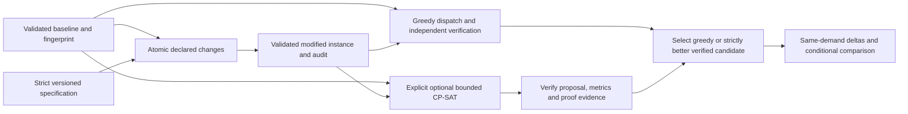

# M04: Conditional production what-if scenarios

M04 compares an immutable baseline with explicit hypothetical capacity changes.
It reuses M02 entities, the frozen whole-stage-minute-v1 policy, M03A's reference,
independent verifier and metrics, M03B's unchanged optimizer, and M03C resource
controls. Inputs are explicitly synthetic. These are conditional planning
calculations, without causal productivity, factory-forecast or financial claims.
See [ADR 0012](../decisions/0012-atomic-what-if-and-verified-selection.md).

## Boundaries and modules

| Module | Responsibility |
| --- | --- |
| `scenarios/contracts.py` | Frozen version-1 specification, typed changes, provenance and bounded request |
| `scenarios/loading.py` | Strict JSON parsing with existing planning primitives |
| `scenarios/application.py` | Pure atomic transformation, audit trail, demand/identity checks |
| `scenarios/metrics.py` | Same-demand scalar deltas, units and frozen objective ordering |
| `scenarios/selection.py` | Independent verification, optional native result validation and selection |
| `scenarios/worker.py` | Private bounded process around the unchanged optimizer |
| `scenarios/engine.py` | Baseline/scenario orchestration and versioned comparison report |
| `scenarios/cli.py`, `__main__.py` | Offline input loading, structured output and exit codes |
| `execution.py` | Shared existing memory/watchdog controls and model-size envelope |

The scenario domain never depends on a benchmark generator. Existing M03C resource
and lossless-input serialization helpers were moved to shared locations; old
benchmark imports remain compatible. Instance input serialization now lives in
`scheduling.loading.instance_json`. No optimizer, dispatcher or verifier source
changed. No dependency, API, database, frontend, deployment or ML integration added.



## Specification schema

The complete supported top-level shape is:

```json
{
  "schema_version": 1,
  "baseline_instance_id": "synthetic:m04-capacity",
  "baseline_fingerprint": "<64 lowercase SHA-256 hexadecimal characters>",
  "scenario_id": "additional-workers",
  "label": "Additional qualified workers, hypothetical",
  "provenance": {
    "source_id": "synthetic:planner-assumption",
    "synthetic": true,
    "assumptions": ["Additional staff are assumed qualified for the declared capability."]
  },
  "changes": [
    {"operation": "set_workers", "line_id": "LINE", "worker_count": 3}
  ],
  "scheduling": {"method": "greedy"}
}
```

The illustrative fingerprint placeholder is not executable. The versioned
[additional-workers specification](../../examples/scenarios/additional-workers.json)
contains the exact fingerprint of its
[baseline](../../examples/scenarios/capacity-baseline.json).

Unknown/missing fields, duplicate JSON keys, malformed/nonfinite numbers, unknown
operations and conflicting configuration fail explicitly. Integer fields reject
booleans and fractional numbers. Input efficiencies are JSON numbers parsed exactly
as Decimal, never numeric strings or binary floats. IDs/labels/source text must be
canonical nonblank strings without controls. Changes are an ordered array of at
most 1,000 entries; an empty array and explicit no-op edits are valid.

`scheduling` is optional and defaults to greedy. Explicit `greedy_with_cp_sat`
permits an optional `solver` object with the existing SolverConfiguration keys:

```json
{
  "method": "greedy_with_cp_sat",
  "solver": {
    "random_seed": 42,
    "workers": 1,
    "wall_time_seconds_per_phase": 1,
    "deterministic_time_per_phase": 1,
    "benchmark_mode": true
  }
}
```

Omitted solver keys use existing recorded defaults: seed 42, worker 1, wall 10 seconds
and deterministic 1.0 per phase, benchmark mode enabled. Seed must fit nonnegative
int32. M04 allows wall budgets in [0,10], deterministic budgets in [0,1], exactly
one worker and benchmark mode. Fractional time budgets convert explicitly to native
float seconds; values beyond the declared bounds or underflowing to zero fail.
Zero is intentional and permits a no-incumbent test. Greedy rejects unused solver
configuration rather than silently ignoring it. No physical planning input defaults
are created by these solver defaults.

## Supported operations

| Operation | Required payload beyond `operation` | Semantics |
| --- | --- | --- |
| `set_workers` | `line_id`, `worker_count` | Replace nonnegative integer crew size on an existing line |
| `set_efficiency` | `profile_id`, `assumed_efficiency` | Replace an existing profile's Decimal fraction in [0,1] |
| `set_availability` | `line_id`, `availability` | Set existing line to `available` or `unavailable` |
| `add_assignment` | `assignment` | Complete ShiftAssignment: assignment_id, line_id, shift_id, profile_id |
| `remove_assignment` | `assignment_id` | Remove the existing assignment without inferred downtime cleanup |
| `add_downtime` | `downtime` | Complete PlannedDowntime: downtime_id, assignment_id, interval, reason |
| `replace_downtime` | `downtime` | Replace the existing downtime ID with the complete supplied record |
| `remove_downtime` | `downtime_id` | Remove the existing downtime explicitly |

No arbitrary patches are supported. Added assignments use already declared shifts,
profiles, capabilities and working dates. The reserve shift in the worked example
is explicit baseline data, initially unassigned. New shift definitions, profiles,
lines, capabilities, order changes and hidden staffing transfers are unsupported.
An efficiency edit records the scenario's synthetic source and clears any evidence
reference; effective dates and other profile fields remain unchanged.

## Atomic application, conflicts and identity

Application has no I/O and never mutates baseline objects. Changes operate in order
on local keyed copies. Adds require an absent target ID; replacements/removals
require a present ID. More than one edit to the same line field/profile-efficiency
field is a SCENARIO_CONFLICT. All assignment lifecycle operations share one key per
assignment ID; downtime lifecycle operations share one key per downtime ID. Even
repeated equal edits conflict. Workers and availability may both change on one line.

The complete final aggregate is constructed and validated atomically through the
unchanged M02/M03 constructors. Intermediate dangling references may exist only
inside the transaction. Removing an assignment with planned downtime therefore
requires explicitly removing or reassigning that downtime in the same transaction;
the removal order is recorded but need not keep every intermediate state valid.
Final dangling references are rejected, with no inferred cleanup or partial result.
Overlapping assignments, wrong profile-line references, ineffective profiles,
nonworking dates, outside-shift downtime and non-minute endpoints remain invalid.
Overlapping downtime reasons remain valid and are unioned by existing availability
logic; they are not silently deleted as conflicts.

Orders, quantities, styles/standards, priority, release/due dates, ordered stages,
capabilities, shift definitions, working dates, unavailable periods, horizon, offset
and allocation granularity remain unchanged. A demand fingerprint covers all typed
orders and styles. The orchestration checks demand again before comparing results.

The derived instance ID is `whatif:<scenario_id>:<transformation-hash-prefix>`.
The transformation hash includes baseline binding, ordered changes, label and
provenance, while excluding scheduling settings. The separate full specification
fingerprint includes scheduling settings. Thus a budget/method change does not
rename the physical scenario; reversing changes does change its declared identity.
Final fingerprints use the existing canonical typed SchedulingInstance helper.
Collection order is preserved: replacements retain position and additions append.

The audit contains a 1-based index, operation, target ID, complete before/after
records (null for addition/removal) and an explicit changed flag. A no-op still
produces a new scenario identity/provenance, with identical physical capacity.

## Selection, independent verification and resources

For each of baseline and scenario:

1. Run the unchanged greedy dispatcher; independently verify the proposal and
   calculate existing metrics. A failed reference verification aborts comparison.
2. If CP-SAT is explicitly requested and permitted, run it in a separate hard-limited
   process. Parent-side operation count rejects oversized requests before launch.
3. Reparse and independently verify any returned proposal; recompute all metrics and
   compare its three objective values with the native claims. Check requested solver
   configuration, exact zero gaps, phase sequence, proof count and incumbent source.
4. Select CP-SAT only if its tuple is strictly smaller than that instance's greedy
   tuple: unfinished units, completed-order priority-weighted tardiness, makespan.
5. Keep greedy for a tie, worse result, missing incumbent/dependency, invalid evidence,
   unsupported range, resource rejection, child failure or watchdog termination.

A verified FEASIBLE or retained earlier-phase incumbent can win on its actual tuple;
its incomplete proof remains explicit. Proof is never inferred from equality of a
FEASIBLE bound/incumbent. First-phase UNKNOWN fabricates no schedule. Later UNKNOWN
may retain only a previously verified real incumbent under the existing solver policy.
INFEASIBLE/MODEL_INVALID status and resource termination are separate outcomes.

The selected report records producer/algorithm, verified schedule/metrics, proof
levels and fallback reason. The optimizer attempt separately records status,
version, phases, objective bounds, retained source, candidate verification/metrics,
same-instance comparison and diagnostics. A CP-SAT tie can be fully proven while
the selected producer remains greedy; candidate proof is not transferred to the
selected greedy record. Invalid candidates have no accepted metrics or proof claim.

The inherited envelope is 300 operations, 20,000 eligible alternatives, 25,000
variables and 90,000 initial-model constraints. Worker sizing uses the unchanged
builder, discards that model, then calls the unchanged optimizer. Up to two proven
objective-fixing equalities may be added later. The worker's entire lifetime is
bounded by 768 MiB committed job memory and a 60-second watchdog on Windows; suspended
launch and exact named-job membership prevent an unguarded interpreter race.
Linux retains the existing RLIMIT_AS backend, without a local validation claim.
M04 cannot increase this envelope through its evaluation API; lower limits are
permitted. Each comparison requests at most two native workers, serially, so their
watchdogs permit at most 120 seconds total plus parent/reference work. The M03C batch
deadline is not used by this two-instance operation. Preparation can be resource
limited too; a rejected native sizing pass does not invalidate verified greedy.

Greedy output has no measured runtime and is byte-reproducible in the worked cases.
Native construction, solve, memory, sizing and process measurements appear only
under top-level `runtime`. Wall-limited candidate/proof outcomes can still vary
outside runtime, as measured in [M03C](../experiments/M03C-solver-scalability.md).
No universal CP-SAT repeatability or factory readiness is claimed.

## Metrics, deltas and attribution

Both selected and greedy comparisons preserve identical demand. The report includes
complete/incomplete/partial orders, finished/unfinished units, on-time/late completed
orders, total/weighted tardiness, makespan, utilization, available/consumed/unused
line/labor/standard capacity, rounded slack and existing per-resource/per-order slices.
Allocated stage units are diagnostic work, not finished goods. Tardiness covers
completed orders only and cannot compensate for greater unfinished demand.

Scalar differences are scenario minus baseline. With nonnull operands and nonzero
baseline, percentage change is `(scenario-baseline)/baseline*100`, using the existing
28-digit Decimal context. Otherwise percentage is null with BASELINE_ZERO or
NULL_VALUE. Both zero does not become a fabricated zero percent. Utilization ratios
also include absolute percentage-point differences. Empty makespan stays null in
metrics/deltas; only frozen objective comparison uses zero for an empty real plan.

JSON reports preserve Decimal values as strings and quantities as integers, with
explicit units. Scenario input planning decimals remain numeric JSON tokens. Report
records must not be mistaken for raw planning input without the appropriate parser.

Interpretation identifies increased modeled standard capacity, reduced unfinished
demand, changed utilization denominators and same-instance scheduling gains. Greedy
vs selected results are both visible, so capacity changes and optimizer selection
are not conflated. Aggregate capacity is not interchangeable across incompatible
styles/stages. More capacity or lower utilization is not measured productivity.

## Independent worked examples and measured results

The expectations were declared in ADR 0012 before execution. The main baseline has
one two-person sewing line, efficiency 0.5, standard 1 worker-minute/piece, an 08:00–09:00
shift and explicit 08:20–08:35 downtime. Its 08:00–10:00 horizon also declares a reserve
09:00–10:00 shift without an assignment. Batches A20/B25/C10 have priorities 1/2/3,
release/due date 2030-01-07, fixed +03:00 offset and identical explicit qualification.

Net 45 minutes × workers 2 × efficiency 0.5 = 45 standard minutes. Greedy places A20
in the first 20-minute fragment and B25 in the second 25-minute fragment; C10 remains
unfinished. Added workers 3 give rate 1.5: rounded durations 14/17/7 reserve 57 standard
minutes for 55 units, leaving 10.5 of 67.5 available standard minutes unused.

The routing baseline has simultaneous 10-minute X/Y lines, crews of 1 and 2, efficiency 1,
standard 1, A (18 units) eligible on both and B (10 units) only on X. Baseline greedy completes 28 units.
Increasing X to crew 2 makes A choose X on its finish/ID tie; only 18 units finish,
despite total capacity rising 30→40. A valid full plan remains A on Y and B on X.
Bounded CP-SAT finds it and is selected only in the modified instance. The baseline
keeps greedy on an optimal candidate tie. Relative to the baseline, selected finished
units stay 28 and makespan improves 10→9; the same-instance scheduling gain is 18→28.

| Specification | Producer | Complete/incomplete orders | Finished/unfinished units | Available standard min | Unused standard min | Makespan min | Line util % | Standard util % | vs baseline |
| --- | --- | --- | --- | --- | --- | --- | --- | --- | --- |
| added-shift | greedy | 3/0 | 55/0 | 105 | 50 | 70 | 52.3810 | 52.3810 | BETTER |
| additional-workers | greedy | 3/0 | 55/0 | 67.5 | 10.5 | 59 | 84.4444 | 84.4444 | BETTER |
| capacity-greedy-regression | greedy | 1/1 | 18/10 | 40 | 22 | 9 | 45.0000 | 45.0000 | WORSE |
| capacity-optimizer-recovery | cp_sat | 2/0 | 28/0 | 40 | 12 | 9 | 70.0000 | 70.0000 | BETTER |
| downtime-addition | greedy | 2/1 | 30/25 | 40 | 10 | 55 | 75.0000 | 75.0000 | WORSE |
| downtime-reduction | greedy | 3/0 | 55/0 | 55 | 0 | 60 | 100.0000 | 100.0000 | BETTER |
| downtime-removal | greedy | 3/0 | 55/0 | 60 | 5 | 55 | 91.6667 | 91.6667 | BETTER |
| multiple-changes | greedy | 3/0 | 55/0 | 135 | 76.5 | 26 | 43.3333 | 43.3333 | BETTER |
| no-improvement | greedy | 2/1 | 45/10 | 50 | 5 | 60 | 90.0000 | 90.0000 | TIE |
| reduced-efficiency | greedy | 1/2 | 10/45 | 22.5 | 12.5 | 20 | 44.4444 | 44.4444 | WORSE |
| removed-shift | greedy | 0/3 | 0/55 | 0 | 0 | null | null | null | WORSE |
| unavailable-line | greedy | 0/3 | 0/55 | 0 | 0 | null | null | null | WORSE |

Percentages are rounded to four decimals here; JSON preserves declared Decimal precision. All completed orders in these small examples are on time; total and weighted tardiness are zero. Makespan regressions remain visible (added shift 60→70), even when unfinished demand improves.

Baseline metrics: capacity case completes 2/3 orders, 45 units, 10 unfinished, 45 available/0 unused standard minutes, makespan 60, line/standard utilization 100%. Routing baseline completes 2/2 orders, 28 units, 30 available/2 unused standard minutes, makespan 10, line utilization 95% and standard utilization 93.3333%.

In the first isolated native repetition, timing/memory samples were:

| Instance | Sizing s | Optimizer build s | Native solve sum s | Optimizer total s | Child total s | Peak commit MiB |
| --- | --- | --- | --- | --- | --- | --- |
| baseline | 0.017341 | 0.000680 | 0.004289 | 0.048073 | 1.574865 | 409.84 |
| scenario | 0.016500 | 0.000692 | 0.004716 | 0.042461 | 1.274042 | 409.80 |

These single local Windows/Python 3.13.14/OR-Tools 9.15.6755 samples include import/launch overhead in child time. They are not a speed comparison or scaling claim.

| Specification | Baseline fingerprint | Scenario fingerprint |
| --- | --- | --- |
| added-shift | 6a6410ea81529136f8df10e547672b0231255b79c614a1f34e0a37599afc438c | 17027da1b2aacb3205082c1dc497dd041bbbc93a0e71371b891328afcd429790 |
| additional-workers | 6a6410ea81529136f8df10e547672b0231255b79c614a1f34e0a37599afc438c | d5ae33ba7ca56dbd97be1f82e64e8c518ee7179f89848f01e688220ad665e785 |
| capacity-greedy-regression | fcd2eab555d5b409f30bb5afd255881f9d1473f905162b9d179d6051daccf5d6 | c1e9a2f13b40f1aa72b8e87fd904d27b60b3f4dce322609131072aecdbdcb539 |
| capacity-optimizer-recovery | fcd2eab555d5b409f30bb5afd255881f9d1473f905162b9d179d6051daccf5d6 | 2733ab1641d90d04860158a81c465339715c3b5172c1b353263a9c147f2aa888 |
| downtime-addition | 6a6410ea81529136f8df10e547672b0231255b79c614a1f34e0a37599afc438c | ac2b69ad79895d519b5e56727b76903719b11a5814783881b79ecc291eae79d9 |
| downtime-reduction | 6a6410ea81529136f8df10e547672b0231255b79c614a1f34e0a37599afc438c | c14d456fd4c9f9b754359b9a0de022afde696de0cbc009be8e1d40079a814e56 |
| downtime-removal | 6a6410ea81529136f8df10e547672b0231255b79c614a1f34e0a37599afc438c | 21b598677c94142fa363f3f6db3f28ceec000ca5f9f669381008bebbdb5230f7 |
| multiple-changes | 6a6410ea81529136f8df10e547672b0231255b79c614a1f34e0a37599afc438c | 45e07ffb085b7faf7b15a7138aa1c47430dab2c97cd53b31eecd11d055155ddf |
| no-improvement | 6a6410ea81529136f8df10e547672b0231255b79c614a1f34e0a37599afc438c | 6db60b843ca23a2f094bf43d5e74d918d91093483813c5ecee1dfddc59694f67 |
| reduced-efficiency | 6a6410ea81529136f8df10e547672b0231255b79c614a1f34e0a37599afc438c | 376d612bf636f2630e33a323fd01eca53384fa9ae3602792ec9682d38708732d |
| removed-shift | 6a6410ea81529136f8df10e547672b0231255b79c614a1f34e0a37599afc438c | d13dc228fff0f8f9c162deb8620f039ebb69ebab36aec5c97c8e9b05f67b3e49 |
| unavailable-line | 6a6410ea81529136f8df10e547672b0231255b79c614a1f34e0a37599afc438c | 572bb8bf2e9adf7256b085262c36a723b5e6226debb7a9a646158b21f090a7a5 |

All 12 valid specifications and two intentionally invalid specifications were run
through the real CLI twice. The 11 greedy examples and two error outputs are fully
reproducible; the CP-SAT example matches after excluding only top-level runtime.
Both native instances report three OPTIMAL phases on each repetition: 12 measured
OPTIMAL phases total, with independently verified candidates. This small result is
not extrapolated to medium/large workloads. Invalid-reference and conflicting-change
examples return INVALID_INPUT with no partial metrics.

## Reproduction and measured verification

Use the unchanged pinned [M03B environment](../../requirements/m03b.txt) for optional
CP-SAT and the complete test suite. Greedy requires only standard-library modules.
From the repository root:

```powershell
.\.venv\Scripts\python.exe -m loometric.scenarios `
  --baseline examples/scenarios/capacity-baseline.json `
  --scenario examples/scenarios/additional-workers.json

.\.venv\Scripts\python.exe -m loometric.scenarios `
  --baseline examples/scenarios/routing-baseline.json `
  --scenario examples/scenarios/capacity-optimizer-recovery.json

.\.venv\Scripts\python.exe -m loometric.scenarios `
  --baseline examples/scenarios/capacity-baseline.json `
  --scenario examples/scenarios/conflicting-changes.json
```

Valid comparisons exit 0, including degraded scenarios and explicit greedy fallback.
The objective relation, fallback and proof fields carry those distinctions. Invalid
input/comparison exits 2 with structured error JSON and no accepted metrics. The CLI
writes only stdout; redirect generated reports to ignored data/processed/ or .tmp/.
The measured local reports are in `data/processed/m04-worked/`, never versioned.

Final full pytest: **812 passed in 50.77 seconds** (716 existing + 96 scenario tests).
The initial complete run before strengthening data-isolation checks passed 811 in
60.84 seconds. The final audit resolves both absolute and relative protected paths,
confirms a relative probe is blocked before I/O, and exercises greedy and native paths.
Focused combined regression run: 328 passed in 18.25 s. Tests cover immutable baselines,
strict numeric/config schemas, conflict and atomic-reference rules, profiles,
calendars, precedence, exact hand calculations, same demand, null/zero denominators,
independent verification, strict selection, resource guards and no protected ML
access. Actual guarded integration covers OPTIMAL and zero-budget UNKNOWN. Controlled
status injection covers FEASIBLE, retained incumbents, INFEASIBLE/MODEL_INVALID,
invalid evidence and process/resource errors; these are not measured natural timeouts.

All six existing M03B CLI outputs match their saved non-runtime reports. Existing
tests preserve M03A reference snapshots. Old algorithms, frozen data split, earlier
reports/contracts, instruction ignore rules and protected ML boundaries remain
unchanged. The shared resource/serialization moves are explicit compatible refactors.
An initial missing RemoveDowntime import caused 24 focused failures and was corrected;
no validation rule or frozen policy was weakened.

Final Ruff lint passed; Ruff format check reported **144 files already formatted**;
`pip check` reported no broken requirements and all **23 exact pins** matched.
Persisted-artifact review independently reverified **48 selected plans, 48 greedy
plans and 4 native candidates**, recomputing metrics/objectives and every delta.
The 11 valid greedy and two rejected outputs were byte-identical across repetitions;
the native example matched all non-runtime fields. **143 protected old file hashes**
matched. The five intentionally changed old files are the compatible shared-helper
refactors: benchmark design/generation/resources, scheduling loading and the resource
test import. Existing optimizer, dispatcher, verifier and metric source is unchanged.

## Limitations and M05 readiness

M04 currently accepts explicit synthetic baselines/assumptions. Staff are assumed
qualified under unchanged capabilities; efficiencies and standards remain supplied
uncalibrated assumptions. No worker sharing, material availability, setups, WIP,
splitting, rework, economic valuation, factory data access or learned capacity input
is introduced. Native limits bound optimizer workers, not all possible greedy/input
processing on arbitrarily large caller data. Capacity/metric changes are conditional
on the fixed model and selected method, without causal or business guarantees.

The versioned local contracts and acceptance tests are a foundation for M05 API
integration. A separate API milestone still needs transport/payload limits, caller
authorization, cancellation and error mapping, decimal representation, concurrency
budgets and persistence decisions. It must preserve baseline fingerprints, immutable
transactions, independent verification, explicit producer/proof/fallback fields and
resource bounds. No HTTP service, database, frontend, deployment or M05 starts here.
